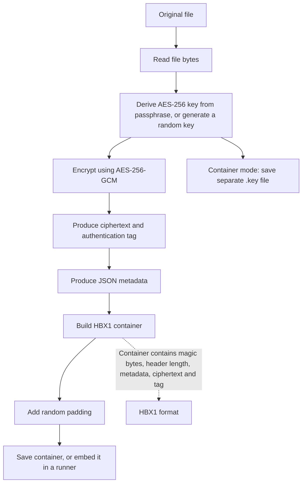
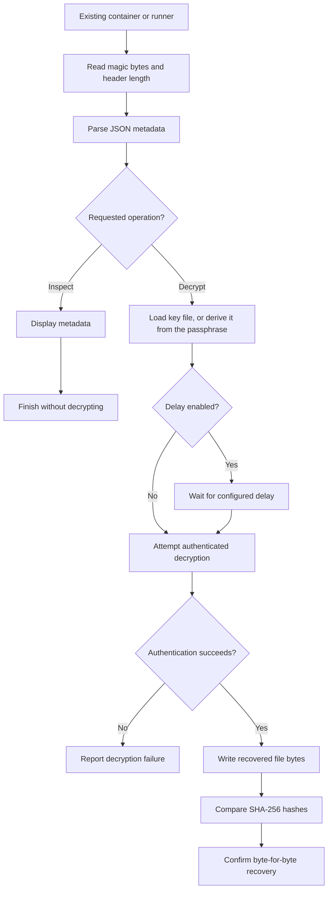
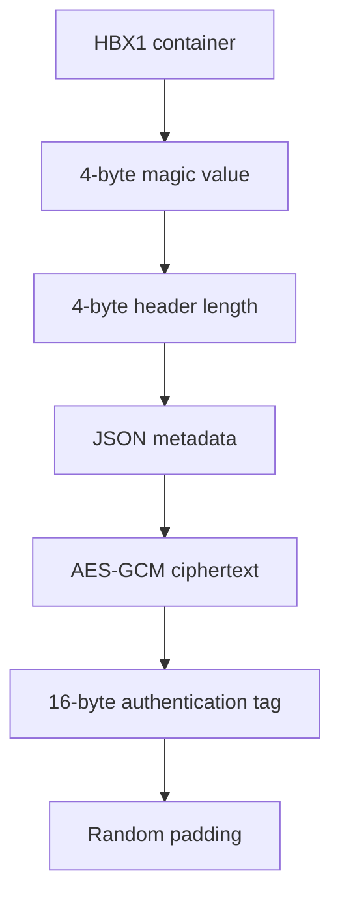
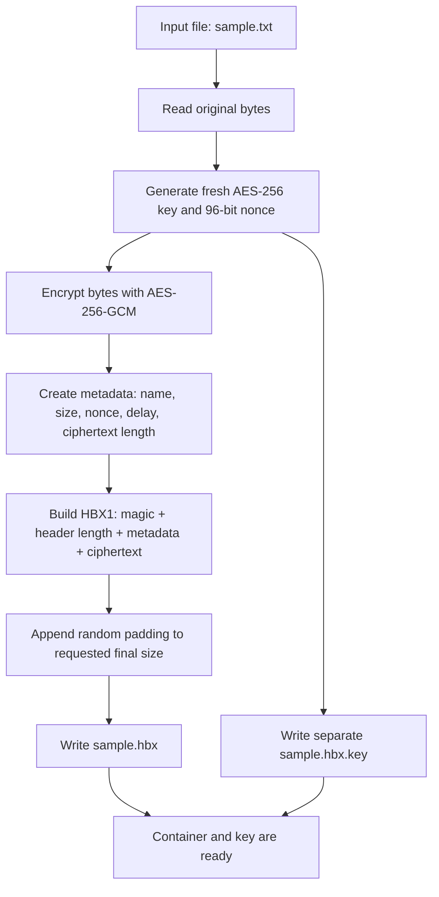
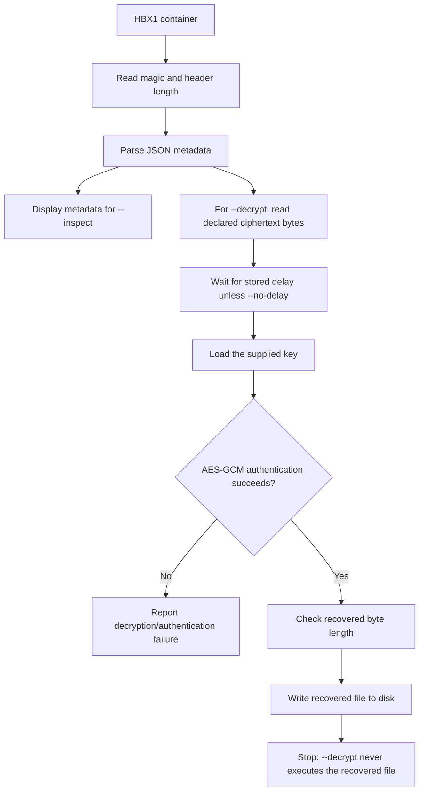
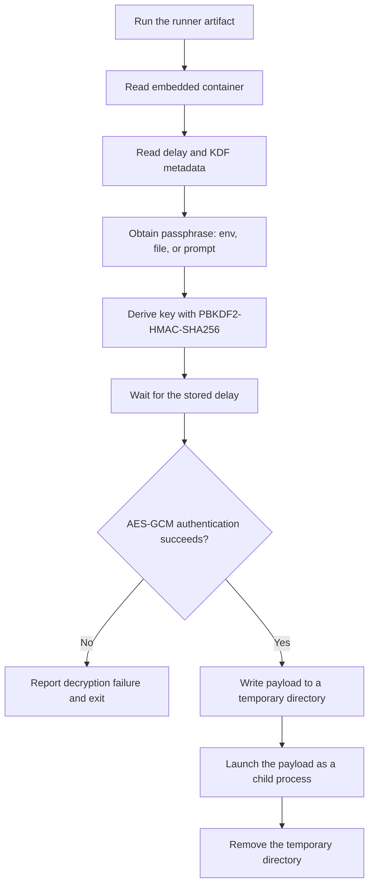
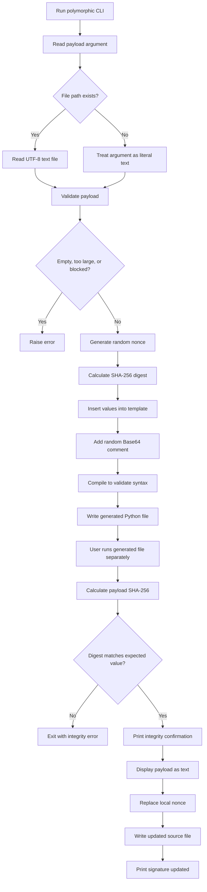
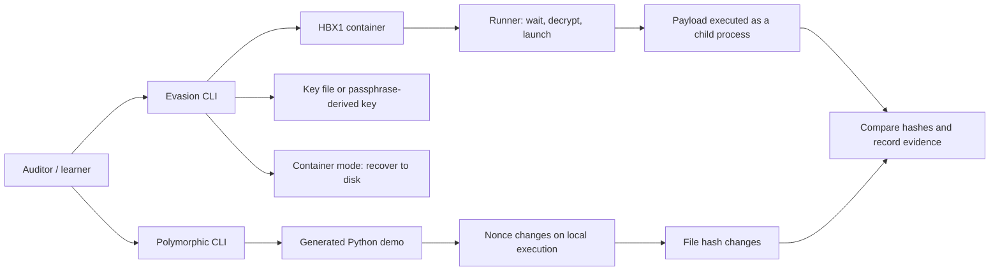

# Hidden-Bytes — Safe Educational Edition

> **Purpose:** study binary containers, authenticated encryption, file-size manipulation, delayed self-extraction, file-level polymorphism, self-modification, integrity checking, and defensive detection in a controlled lab.
>
> **Safety boundary:** this edition does not implement antivirus evasion, a working reverse shell, remote command execution, persistence, or any technique whose purpose is to defeat a security product. It does not claim to bypass Microsoft Defender, VirusTotal, or any other security product.

## Contents

- [1. Project overview](#1-project-overview)
- [2. Subject and audit scope](#2-subject-and-audit-scope)
- [3. Requirements and setup](#3-requirements-and-setup)
- [4. Tool 1 — Evasion / HBX1 container](#4-tool-1--evasion--hbx1-container)
- [5. Tool 2 — Polymorphic generator](#5-tool-2--polymorphic-generator)
- [6. End-to-end lab walkthrough](#6-end-to-end-lab-walkthrough)
- [7. Technical concepts](#7-technical-concepts)
- [8. Diagrams](#8-diagrams)
- [9. Audit checklist and evidence](#9-audit-checklist-and-evidence)
- [10. Defensive analysis](#10-defensive-analysis)
- [11. Limitations and known caveats](#11-limitations-and-known-caveats)
- [12. Ethics and lab safety](#12-ethics-and-lab-safety)

---

## 1. Project overview

Hidden-Bytes is a command-line educational project with two separate programs:

| Program | Main purpose | Output | Does it execute the input file? |
|---|---|---|---|
| `evasion` | Encrypt a file into an authenticated HBX1 container, add random padding, and package it into a self-extracting runner that waits for a delay and then launches the recovered program | `.hbx` container (+ `.key` file) **or** a self-extracting runner | **Yes, in `--mode runner`** — the runner decrypts the payload and launches it as a normal child process after the delay. In `--mode container` it only writes the recovered file to disk |
| `polymorphic` | Generate a harmless Python program whose inert signature changes while its displayed text stays the same | A generated `.py` program | It executes only its own safe demo logic when the generated script is run; the supplied payload is displayed as text, not executed |

The `evasion` name is retained because it comes from the assignment. The implementation is a **container, encryption, and delayed self-extraction demonstration**, not an antivirus-evasion mechanism.

### What this project demonstrates

- AES-256-GCM authenticated encryption.
- A simple binary container format with a magic value, metadata, ciphertext, and padding.
- Exact final-size calculation for a requested padding increase.
- A recovery delay that is **enforced by the produced artifact itself**, not only by the tool.
- A self-extracting runner: one file that carries the encrypted payload, waits, decrypts, and launches the recovered program.
- Passphrase-based key derivation with PBKDF2-HMAC-SHA256, and a dependency-free AES-GCM implementation so the runner needs nothing but a Python interpreter.
- Authentication failure when the wrong key, wrong passphrase, or modified ciphertext is supplied.
- A generated program with randomized inert data and a self-updating signature.
- Why whole-file hashes change when even non-functional bytes change.
- How defenders can investigate unusual file structure and behavior.

### What it deliberately does not implement

- Bypassing or disabling endpoint protection.
- A claimed Defender or VirusTotal detection-bypass percentage.
- A reverse shell, remote listener, command-and-control, or remote command execution.
- Persistence, privilege escalation, stealthy process injection, or anti-analysis tricks.
- The optional bonus features from the original subject.

These exclusions are part of the scope, not unfinished features to silently assume are present.

---
## HBX1 Encryption and Recovery Flow

### 1. Encryption flow




### 2. Inspection and recovery flow



### 3. How to read the container



**Important notes**

- **Magic value:** identifies the container format.
- **Header length:** a 4-byte unsigned, big-endian integer specifying the JSON metadata length in bytes.
- **JSON metadata:** stores information such as the algorithm, nonce, original filename, original size, ciphertext length, recovery delay, and optionally the key-derivation parameters.
- **Ciphertext and authentication tag:** AES-256-GCM encrypts the original bytes and produces a tag used to verify authenticity and integrity during decryption.
- **Random padding:** increases the artifact size; it is not part of the original file and does not strengthen the encryption.
- **Recovery delay:** the delay is stored in the metadata and enforced before the payload is recovered. In runner mode the *artifact* enforces it; in container mode the `--decrypt` command enforces it.
- **SHA-256 comparison:** matching hashes provide evidence that the recovered file is byte-for-byte identical to the original.

**Note:** `--inspect` displays metadata without authenticating the ciphertext. Authentication is checked when decryption is attempted.


---

## 2. Subject and audit scope

The original subject discusses binary manipulation, encryption, file-size changes, delayed behavior, polymorphism, reverse shells, and antivirus detection. This repository implements safe demonstrations of several underlying concepts, while leaving operational malware capabilities out.

| Subject / audit topic | This implementation | How to demonstrate it |
|---|---|---|
| Encrypt an input file | Implemented using AES-256-GCM | Encrypt, then recover and compare SHA-256 hashes |
| Modify final file size | Implemented using random padding | Compare original size and artifact size |
| Requested size increase | Exact to the rounded MiB amount requested | Check `stat` / file properties and the CLI's size report |
| Delay | Stored in metadata and enforced by the produced artifact before the payload runs | Use a non-zero delay, run the artifact, and time the wait |
| Inspect binary/container structure | Implemented for HBX1 metadata | Run `--inspect` and examine the layout diagram |
| Polymorphic variants | Implemented with random nonce/comment data | Generate two files and compare hashes |
| Self-modification | Implemented by changing the generated script's nonce | Hash a generated script, run it, and hash it again |
| Stable behavior | Same embedded message is displayed on each run | Capture output from multiple runs |
| Native Windows PE output | Produced by `--build-exe` (PyInstaller) inside the VM | A `.py` file or `.exe` filename does not by itself establish PE validity; check the file type |
| Defender / VirusTotal bypass | Not implemented or claimed | Record this as out of scope; do not report an unmeasured bypass rate |
| Reverse-shell connection | Not implemented | Explain the threat model and defensive telemetry; no shell or connection is created |
| Isolated Windows VM | Must be verified manually by the auditor | Capture hypervisor network and integration settings |
| Bonus features | None implemented | Mark as not implemented |

**Important audit wording:** the delay is enforced by the **artifact itself** in runner mode — the produced file waits, then decrypts and launches the payload. The tool does not need to be running for the wait to happen. The delay is a *pre-execution* delay: the payload has not started yet when the wait ends.

---

## 3. Requirements and setup

### Prerequisites

- Python 3.10 or newer.
- The packages listed in `requirements-dev.txt` (including `cryptography` and `pytest`).
- A terminal: PowerShell on Windows, or a shell on Linux/macOS.
- For the subject demonstration, a dedicated Windows 10/11 virtual machine configured and inspected by the auditor.
- Optional, only for `--build-exe`: `python -m pip install pyinstaller` inside the isolated VM.

### Recommended repository layout

```text
Hidden-Bytes/
├── hidden_bytes/
│   ├── __init__.py
│   ├── evasion/             # HBX1 packaging tool (package)
│   │   ├── __init__.py      # public API re-exports
│   │   ├── __main__.py      # enables `python -m hidden_bytes.evasion`
│   │   ├── constants.py
│   │   ├── encoding.py
│   │   ├── args.py
│   │   ├── container.py
│   │   ├── crypto.py
│   │   ├── pure_aes.py      # dependency-free AES-256-GCM, spliced into runners
│   │   ├── runner.py        # self-extracting runner generation
│   │   └── cli.py
│   └── polymorphic.py
├── evasion                  # optional launcher script
├── polymorphic              # optional launcher script
├── tests/
├── requirements.txt
├── requirements-dev.txt
├── README.md
└── output/                  # generated examples; optional
```

The precise test filenames may differ in your checkout. Run every command below
from the **project root** so that the `hidden_bytes` package is importable.

### Windows PowerShell

```powershell
py -m venv .venv
.venv\Scripts\Activate.ps1
py -m pip install -r requirements-dev.txt

py -m hidden_bytes.evasion --help
py -m hidden_bytes.polymorphic --help
```

If PowerShell blocks virtual-environment activation due to local policy, use the Python executable in `.venv\Scripts\python.exe` directly rather than changing a system-wide execution policy just for this project.

### Linux / macOS

```bash
python3 -m venv .venv
source .venv/bin/activate
python3 -m pip install -r requirements-dev.txt

python3 -m hidden_bytes.evasion --help
python3 -m hidden_bytes.polymorphic --help
```

If the repository includes executable wrapper scripts, they may also be used:

```bash
./evasion --help
./polymorphic --help
```

### Isolated lab configuration

Before any Windows demonstration, ask the auditor to verify:

1. The VM uses **Host-Only** or **Internal Network** mode as required by the lab scope.
2. Shared folders, shared clipboard, and drag-and-drop are disabled.
3. A clean snapshot exists and can be restored.
4. Only owned, harmless test files are used.
5. No confidential organizational file is uploaded to a public scanning service.
6. Evidence is saved without exposing keys or sensitive sample contents.

A README cannot prove the VM is isolated. Isolation must be checked in the hypervisor settings.

---

## 4. Tool 1 — Evasion / HBX1 container

> **Scope note:** `evasion` is the assignment's original tool name. This safe edition demonstrates authenticated encryption, binary-container parsing, padding, and delayed self-extraction. It does **not** bypass antivirus and does not implement a malware loader: the runner launches the recovered program as an ordinary child process, with no injection, no persistence, and no concealment.

### 4.1 What the tool does

`hidden_bytes.evasion` has three modes:

- `--encrypt`: reads a file as bytes, encrypts it using AES-256-GCM, and writes the result in one of two shapes:
  - `--mode runner` (default): a **self-extracting runner**. One file that contains the launcher and the encrypted container. Running it waits for the recorded delay, decrypts the payload, writes it to a temporary directory, launches it, and removes the temporary directory.
  - `--mode container`: a plain `.hbx` data container plus a `<output>.key` file. Nothing is executed; the file is only data.
- `--inspect`: parses and displays the container metadata without decrypting its contents. Works on both a `.hbx` container and a runner.
- `--decrypt`: reads a container (or a runner) and the key, waits for the recorded recovery delay unless `--no-delay` is supplied, authenticates and decrypts the ciphertext, then writes the recovered bytes to disk. It never executes the recovered file.

The optional `--add-size` value requests an increase in the **final artifact size**. The tool fills the artifact with random padding to reach the target size. Padding is not encrypted content and does not make the encryption stronger.

### 4.1.1 How the runner enforces the delay

This is the key difference from a plain container, and it is what the audit's *"the program enforces the execution delay correctly"* check looks for.

```text
evasion --encrypt target --output obfuscated
        │
        ├─ encrypt payload  →  AES-256-GCM container (ciphertext + metadata)
        ├─ embed container  →  inside the runner artifact
        └─ store delay      →  in the container header (delay_seconds)

$ ./obfuscated
[INFO] Hidden-Bytes self-extracting runner.
[INFO] Execution delayed by 101 seconds...     ← the artifact waits
[INFO] Binary decrypted successfully.
[INFO] Target program executed.                ← only now is the payload run
```

The delay is **stored in the artifact and enforced by the artifact**. The tool does not need to be running, and no separate `--decrypt` step is involved. A defender watching the endpoint sees a process that stays alive doing nothing for 101 seconds and then spawns a child process — that behaviour is visible to behavioural monitoring even though the file's bytes are opaque.

Two details make this work in practice:

- **The key is not stored in the artifact.** The container is protected by a passphrase; the key is derived with PBKDF2-HMAC-SHA256 (200,000 iterations, 16-byte random salt) at run time. The artifact therefore cannot be unpacked without the passphrase.
- **The runner has no third-party dependency.** The AES-256-GCM implementation is spliced into the generated launcher, so the artifact needs nothing but a Python 3 interpreter — no `pip install` in the lab VM.

### 4.2 CLI reference — all options

Display help:

```bash
python3 -m hidden_bytes.evasion --help
```

The module expects exactly one mode (`--encrypt`, `--decrypt`, or `--inspect`) and a positional input path called `source`.

| Option | Meaning | Notes |
|---|---|---|
| `source` | Input file or HBX1 container | Required positional argument |
| `--encrypt` | Encrypt/package the source file | Must be used with `--output` |
| `--decrypt` | Recover a file from an HBX1 container or runner | Must be used with `--output` |
| `--inspect` | Print container metadata | Does not decrypt the payload; works on containers and runners |
| `--output PATH` | Destination path | Required for encryption and decryption |
| `--mode {runner,container}` | Shape of the encrypted artifact | Default: `runner` (self-extracting). Use `container` for a plain `.hbx` data file |
| `--add-size MB` | Requested increase in final artifact size | Help default: `0.01` MB; `1` requests 1 MiB (1,048,576 bytes); `101` requests 101 MiB |
| `--delay SECONDS` | Recovery delay stored in the container | Help default: `101` seconds; set a small value such as `2` for a quick demo |
| `--passphrase TEXT` | Passphrase protecting the container | Prompted for when omitted; the derived key is never written to disk |
| `--passphrase-file PATH` | Read the passphrase from the first line of a file | Useful for scripted demonstrations |
| `--key PATH` | Key file to use during decryption | Only needed for `--mode container`; encryption generates `<output>.key` automatically |
| `--no-delay` | Skip the stored delay during recovery | Useful for controlled tests; do not use it when demonstrating the delay |
| `--build-exe` | Package the runner as a single native executable with PyInstaller | Produces a real `.exe` on Windows. Requires `--mode runner` and PyInstaller installed |

Passphrases can also be supplied through the `HBX_PASSPHRASE` environment variable, which is the simplest option for a repeatable demonstration:

```bash
export HBX_PASSPHRASE='lab-passphrase'
```

The defaults shown above are those reported by this project's CLI help. Explicitly set `--add-size` and `--delay` in demonstrations so the behavior is reproducible.

### 4.3 Complete Linux / Kali walkthrough

Run commands from the repository root (`~/Desktop/hidden-bytes`) with the virtual environment activated.

#### Step 1 — Create a harmless sample

```bash
printf 'Hello from Hidden-Bytes -- sample file\n' > sample.txt
wc -c sample.txt
```

`wc -c` shows the exact input length. The example string above is **39 bytes**, including its final newline.

#### Step 2 — Encrypt and add 1 MiB to the final size

```bash
export HBX_PASSPHRASE='lab-passphrase'

python3 -m hidden_bytes.evasion \
  --encrypt sample.txt \
  --output sample.hbx \
  --add-size 1 \
  --delay 2 \
  --mode container
```

Expected artifacts:

```text
sample.txt       # original test file
sample.hbx       # encrypted HBX1 data container
sample.hbx.key   # generated key; keep it private
```

Representative output from the tested 39-byte sample:

```text
[OK] Encryption completed.
[INFO] Input:       sample.txt
[INFO] Container:   sample.hbx
[INFO] Key:         .../sample.hbx.key
[INFO] Original:    39 bytes
[INFO] Container:   1048615 bytes
[INFO] Added:       1048576 bytes
[INFO] Delay:       2 second(s)
[INFO] The container is data only; nothing is executed.
```

The exact key path depends on where the repository is located. `--add-size 1` requests 1 MiB (1,048,576 bytes) above the input size, so this sample's final container is 39 + 1,048,576 = **1,048,615 bytes**. Metadata and encryption overhead are accounted for inside that final-size target.

#### Step 3 — Inspect the container

```bash
python3 -m hidden_bytes.evasion --inspect sample.hbx
```

The command prints metadata similar to:

```json
{
  "algorithm": "AES-256-GCM",
  "artifact_type": "container",
  "ciphertext_length": 55,
  "container_ciphertext_bytes": 55,
  "container_magic": "HBX1",
  "container_size_bytes": 1048615,
  "delay_seconds": 2.0,
  "nonce": "<random Base64 value>",
  "original_name": "sample.txt",
  "original_size": 39
}
```

The nonce changes between encryption runs, so the example nonce above is a placeholder. Inspection shows metadata; it does not reveal the secret key and does not by itself validate the ciphertext's authenticity. Authentication is checked during decryption.

#### Step 4 — Recover the original file

```bash
python3 -m hidden_bytes.evasion \
  --decrypt sample.hbx \
  --output recovered.txt \
  --key sample.hbx.key
```

Expected behavior for a container created with `--delay 2`:

```text
[INFO] Recovery delayed for 2 second(s)...
[OK] Recovery completed.
[INFO] Recovered file: recovered.txt
[INFO] The recovered file was written to disk but was NOT executed.
```

For a quick test that skips the configured wait:

```bash
python3 -m hidden_bytes.evasion \
  --decrypt sample.hbx \
  --output recovered-no-delay.txt \
  --key sample.hbx.key \
  --no-delay
```

Use a different output filename if you want to keep both recovery results. `--no-delay` bypasses only the demonstration wait; it does not bypass encryption or authentication.

#### Step 5 — Verify recovery using SHA-256

```bash
sha256sum sample.txt recovered.txt
```

In the test run shared during this project, both files produced the same hash:

```text
06570c37ec2d0014c9bb0c10e6e4934f13de8adc8ca73b11107afdeebdca2310  sample.txt
06570c37ec2d0014c9bb0c10e6e4934f13de8adc8ca73b11107afdeebdca2310  recovered.txt
```

That hash belongs to the exact file content used in that recorded run. If you create a new sample using the command above, the hash will be different, but the original and recovered hashes should still match. Matching SHA-256 hashes provide evidence that the recovered file is byte-for-byte identical to the original.

Alternative byte-for-byte comparison:

```bash
cmp sample.txt recovered.txt && echo 'Files match'
```

Check file sizes:

```bash
stat -c '%n: %s bytes' sample.txt sample.hbx recovered.txt
```

### 4.3.1 The runner flow — the artifact enforces its own delay

This is the demonstration that matches the audit's *"does the program enforce the execution delay correctly?"* check, because the produced artifact itself waits and then launches the payload.

#### Step 1 — Prepare a target program

```bash
cat > simple_program.py <<'EOF'
print("Hello, World!")
EOF
```

#### Step 2 — Build the self-extracting runner

```bash
export HBX_PASSPHRASE='lab-passphrase'

python3 -m hidden_bytes.evasion \
  --encrypt simple_program.py \
  --output obfuscated.pyz \
  --add-size 101 \
  --delay 101
```

Representative output:

```text
[OK] Encryption completed.
[INFO] Input:       simple_program.py
[INFO] Runner:      obfuscated.pyz
[INFO] Original:    23 bytes
[INFO] Runner:      105906199 bytes
[INFO] Added:       105906176 bytes
[INFO] Delay:       101 second(s)
[INFO] Run the runner to trigger the delayed recovery.
```

The size grew by exactly 101 MiB (105,906,176 bytes) — the same accounting used for the container mode.

#### Step 3 — Run it and watch the delay happen

```bash
time python3 obfuscated.pyz
```

Expected output (the run takes just over 101 seconds):

```text
[INFO] Hidden-Bytes self-extracting runner.
[INFO] Execution delayed by 101 seconds...
[INFO] Binary decrypted successfully.
[INFO] Target program executed.
Hello, World!
```

`time` reports roughly `real 1m41s`, which is the objective evidence that the delay is enforced rather than merely recorded.

#### Step 4 — Inspect the runner without decrypting it

```bash
python3 -m hidden_bytes.evasion --inspect obfuscated.pyz
```

```json
{
  "algorithm": "AES-256-GCM",
  "artifact_size_bytes": 105906199,
  "artifact_type": "runner",
  "ciphertext_length": 39,
  "delay_seconds": 101.0,
  "kdf": {
    "env": "HBX_PASSPHRASE",
    "iterations": 200000,
    "name": "PBKDF2-HMAC-SHA256",
    "salt": "<random Base64 value>"
  },
  "nonce": "<random Base64 value>",
  "original_name": "simple_program.py",
  "original_size": 23
}
```

#### Step 5 — Prove the payload is not visible in the artifact

```bash
grep -c "Hello, World!" obfuscated.pyz || echo "plaintext NOT found in the artifact"
```

The payload does not appear as plaintext in the artifact: it is AES-256-GCM ciphertext inside the container.

#### Step 6 — Recover the payload from a runner without running it

```bash
python3 -m hidden_bytes.evasion \
  --decrypt obfuscated.pyz \
  --output recovered.py \
  --no-delay
cmp simple_program.py recovered.py && echo 'Files match'
```

### 4.3.2 Building a real `.exe` (Windows VM)

On Windows the audit expects an `.exe`, not a Python archive. The `--build-exe` option packages the launcher and the container into a single native executable with PyInstaller.

Install PyInstaller **inside the isolated VM**:

```bash
python -m pip install pyinstaller
```

Then build the executable:

```bash
python -m hidden_bytes.evasion \
  --encrypt simple_program.exe \
  --output evaded_program.exe \
  --add-size 101 \
  --delay 101 \
  --build-exe
```

Run it:

```cmd
> evaded_program.exe
[INFO] Hidden-Bytes self-extracting runner.
[INFO] Execution delayed by 101 seconds...
[INFO] Binary decrypted successfully.
[INFO] Target program executed.
```

Two practical notes for the `.exe` build:

- **The bundled Python runtime adds fixed overhead** (roughly 9–15 MB depending on the platform and interpreter). The size target therefore has to exceed that overhead; `--add-size 101` does. If you request a size that is too small, the tool reports the minimum it needs instead of failing silently.
- **The size is exact.** The padding is appended after the packaged archive. The PyInstaller loader locates its archive with a back-to-front scan for its cookie, so trailing bytes do not affect execution. The final file is exactly `original_size + requested_size` bytes.

### 4.4 Other useful test commands

Inspect the CLI options:

```bash
python3 -m hidden_bytes.evasion --help
```

Create a second container with a different delay and size increase:

```bash
python3 -m hidden_bytes.evasion \
  --encrypt sample.txt \
  --output sample-small.hbx \
  --add-size 0.1 \
  --delay 5 \
  --mode container
```

Inspect it:

```bash
python3 -m hidden_bytes.evasion --inspect sample-small.hbx
```

Recover it without waiting (for a quick test):

```bash
python3 -m hidden_bytes.evasion \
  --decrypt sample-small.hbx \
  --output recovered-small.txt \
  --key sample-small.hbx.key \
  --no-delay
```

Compare the recovered content:

```bash
sha256sum sample.txt recovered-small.txt
```

Run the project's automated tests from the repository root:

```bash
python3 -m pytest -q
```

### 4.5 HBX1 container layout

The container is a custom **data format**, not a Windows PE executable.

```text
+-----------------------------------------+
| Magic: "HBX1"                 (4 bytes) |
+-----------------------------------------+
| Header length (uint32, big-endian)       |
+-----------------------------------------+
| JSON metadata                            |
| algorithm, nonce, original name/size,    |
| ciphertext length, recovery delay,      |
| optional kdf block (salt, iterations)    |
+-----------------------------------------+
| AES-GCM ciphertext                       |
| encrypted original bytes + 16-byte tag   |
+-----------------------------------------+
| Random padding                           |
| fills remaining bytes to target size    |
+-----------------------------------------+
```

The `ciphertext_length` metadata field identifies the encrypted section's length, including the GCM authentication tag. The recovery code uses this length to avoid treating padding as ciphertext.

The `kdf` block is present only when the container is protected by a passphrase. It records the derivation function, the iteration count, and the salt — none of which are secret — so the runner can derive the same key later.

### 4.5.1 Runner layout

In runner mode the container is embedded in a single file:

```text
+-----------------------------------------+
| Launcher (Python source)                |
| - reads the embedded container          |
| - derives the key from the passphrase   |
| - waits for the stored delay            |
| - decrypts, writes to a temp dir,       |
|   launches the payload, cleans up       |
+-----------------------------------------+
| HBX1 container                           |
| magic + header + AES-GCM ciphertext     |
+-----------------------------------------+
| Random padding (stored, uncompressed)   |
| fills remaining bytes to target size    |
+-----------------------------------------+
```

The launcher and the container are kept in a zip container, with the payload stored **uncompressed** so the final file size is exactly predictable.

### 4.6 Encryption flow diagram



### 4.7 Inspection and recovery flow diagram



### 4.7.1 Runner flow diagram



### 4.8 What the tool does and does not prove

- **Encryption:** the input bytes are encrypted using AES-256-GCM.
- **Authentication:** a wrong key, wrong passphrase, or modified authenticated ciphertext fails authentication during recovery.
- **Size manipulation:** padding makes the final artifact reach the requested size increase, exactly.
- **Delay:** the wait is enforced **by the produced artifact** before the payload is launched, and it is also honored by `--decrypt`.
- **Integrity evidence:** matching original/recovered SHA-256 hashes demonstrates successful byte-for-byte recovery.
- **No antivirus bypass:** encryption, padding, file-size changes, and matching recovery hashes do not demonstrate Defender or VirusTotal evasion.
- **Key handling:** in `--mode container` the `.key` file is separate from the container but is saved beside it by default; protect it and do not commit it to version control. In `--mode runner` no key file is written at all — the key is derived from the passphrase at run time.
- **Execution transparency:** the runner launches the recovered program as an ordinary child process, prints what it is doing, and removes its temporary directory. It performs no injection, no persistence, and no concealment, and the delay is plainly visible to any behavioural monitor.

## 5. Tool 2 — Polymorphic generator

### 5.1 What it does

`hidden_bytes.polymorphic` generates a Python demonstration program that contains:

- A text payload (or the contents of a UTF-8 text file).
- A SHA-256 digest of that text.
- A random nonce used as a signature value.
- An inert random comment to make independently generated files different.

When the generated program runs, it checks that the embedded text matches the digest, prints the text, and updates its own nonce. Thus, its file hash changes while the displayed message remains the same.

The supplied payload is treated as **text**, not Python code. It is not passed to `eval`, `exec`, a shell, or a process launcher.

### 5.2 Generate a demonstration

PowerShell:

```powershell
py -m hidden_bytes.polymorphic --generate polymorphic_demo.py --payload "Hello from the safe payload"
```

Linux/macOS:

```bash
python3 -m hidden_bytes.polymorphic \
  --generate polymorphic_demo.py \
  --payload "Hello from the safe payload"
```

You can also supply a text file:

```powershell
Set-Content -Path message.txt -Value "This is text, not executable code."
py -m hidden_bytes.polymorphic --generate polymorphic_demo.py --payload message.txt
```

```bash
printf 'This is text, not executable code.\n' > message.txt
python3 -m hidden_bytes.polymorphic \
  --generate polymorphic_demo.py \
  --payload message.txt
```

The generator limits the payload to 4096 UTF-8 bytes and rejects some common shell/process-related tokens. **That token filter is only a basic guardrail, not a security sandbox or a reliable classifier.** The key safety property is that the payload is displayed as text rather than executed.

### 5.3 Observe the changing hash

PowerShell:

```powershell
Get-FileHash polymorphic_demo.py -Algorithm SHA256
py polymorphic_demo.py
Get-FileHash polymorphic_demo.py -Algorithm SHA256
py polymorphic_demo.py
Get-FileHash polymorphic_demo.py -Algorithm SHA256
```

Linux/macOS:

```bash
sha256sum polymorphic_demo.py
python3 polymorphic_demo.py
sha256sum polymorphic_demo.py
python3 polymorphic_demo.py
sha256sum polymorphic_demo.py
```

Expected observations:

1. The program prints the same payload message on each run.
2. It verifies the embedded payload's SHA-256 digest before printing.
3. It changes the nonce stored in its source file.
4. The file's SHA-256 hash changes after the self-modification.

The generated file must be writable for the self-modification step. If it is read-only or located in a directory where the user lacks write permission, the signature update can fail.

### 5.4 Generate two variants and compare them

Generate two files with the same text:

```bash
python3 -m hidden_bytes.polymorphic \
  --generate variant_a.py \
  --payload "Same visible behavior"

python3 -m hidden_bytes.polymorphic \
  --generate variant_b.py \
  --payload "Same visible behavior"

sha256sum variant_a.py variant_b.py
```

The files should have different hashes because their nonce and inert variant comment are randomized. The visible message remains the same.

### 5.5 Polymorphic flow



### 5.6 What “polymorphism” means in this demo

The example illustrates a narrow form of **file-level variation**: bytes change while the intended visible output stays the same. It does not implement machine-code mutation, a native PE rewriter, an encrypted executable loader, or antivirus evasion.

A `.exe` extension does not turn a Python script into a Windows PE file. If a reviewer requires a native executable for a benign demonstration, any packaging should be done separately with an approved application packager inside the isolated VM. That does not make it an evasion tool.

---

## 6. End-to-end lab walkthrough

Use harmless text samples first. These commands are intended to make the behavior easy to show to an auditor.

### Exercise A — Encryption, padding, recovery, and integrity

1. Create `sample.txt` containing a short message.
2. Encrypt it into `sample.hbx` with a short delay such as five seconds (`--mode container`).
3. Inspect the header with `--inspect`.
4. Record the original and container file sizes.
5. Recover to `recovered.txt`.
6. Compare the original and recovered SHA-256 values.
7. Repeat recovery with a deliberately incorrect key file and record that authentication fails. Do not overwrite the original sample during this test.
8. Restore the correct key and verify recovery succeeds again.

### Exercise A2 — Delayed self-extraction (the runner)

1. Create `simple_program.py` that prints `Hello, World!`.
2. Encrypt it into `obfuscated.pyz` with `--add-size 101 --delay 101` (runner mode, the default).
3. Record the file size and confirm the increase is exactly 101 MiB.
4. Run it with `time` and confirm the wall-clock time is at least 101 seconds, and that the payload's own output appears at the end.
5. Inspect the runner and show the `delay_seconds` and `kdf` metadata.
6. Show that the payload's plaintext does not appear in the artifact (`grep`).
7. Recover the payload with `--decrypt --no-delay` and compare it to the original.
8. Run the runner with a wrong passphrase and show that it refuses to decrypt and never launches the payload.
9. On the Windows VM, repeat with `--build-exe` to produce `evaded_program.exe` and confirm the same behaviour and the same exact size accounting.

### Exercise B — Polymorphism and stable output

1. Generate `polymorphic_demo.py`.
2. Record its SHA-256 hash.
3. Run it and record its output.
4. Record its hash again.
5. Run it a second time and record the hash/output.
6. Confirm that the output message remains the same while the source file hash changes.
7. Generate a second variant with the same message and compare its hash.

### Exercise C — Defensive discussion

For each exercise, document:

- What changed in the file?
- Which parts are metadata, encrypted bytes, or inert random data?
- What did the program verify?
- What evidence proves that the original file was recovered correctly?
- What should an endpoint or sandbox monitor?
- Which original subject requirements are deliberately excluded from this safe edition?

Do not claim a Defender or VirusTotal bypass based on file size, encryption, hash changes, or one scan result.

---

## 7. Technical concepts

### AES-256-GCM

AES is a symmetric cipher. “256” refers to the key size in bits. GCM is an authenticated-encryption mode: it encrypts the plaintext and produces an authentication tag. During decryption, a wrong key or modified authenticated ciphertext should cause authentication to fail rather than produce accepted plaintext.

The container stores the nonce and metadata, but not the AES key. In `--mode container` the key is stored separately in `<output>.key`. In `--mode runner` it is not stored anywhere: it is derived from the passphrase at run time.

### PBKDF2-HMAC-SHA256

A passphrase is not a key. PBKDF2-HMAC-SHA256 is a deliberately slow key-derivation function: it runs many iterations of a hash over the passphrase and a random salt, so a brute-force attempt costs far more per guess than a plain hash would. The runner stores the salt and the iteration count in cleartext metadata (that is normal — the salt is not secret), and derives a 256-bit key from them.

### Dependency-free AES in the runner

A generated runner has to work on a machine where nothing is installed. The tool therefore ships a small pure-Python implementation of the parts of AES-256-GCM it needs (the forward cipher for the counter-mode keystream, and GHASH for the tag). It is spliced into the generated launcher at build time, so the artifact needs only a Python 3 interpreter.

The implementation is verified against the `cryptography` package in the test suite, byte for byte, including the FIPS-197 AES-256 test vector. That comparison is what makes the pure-Python version trustworthy.

### SHA-256

SHA-256 maps input bytes to a 256-bit digest. It is useful for checking whether the original and recovered files are byte-for-byte identical. Even a small change in the generated Python source normally changes its SHA-256 digest, which is why the polymorphic demo's hash changes when its nonce changes.

### File size and random padding

The artifact is deliberately padded to a target size. Padding illustrates how file length and high-entropy data can complicate static inspection; it does not prove maliciousness or benignness. Defenders should inspect structure and behavior rather than treating a single size or entropy measurement as a verdict.

### PE structure versus HBX1

A Windows Portable Executable normally has a DOS header, PE/COFF headers, section headers, and sections. HBX1 has a different custom layout. If an input file happens to be a PE, this tool encrypts its bytes as opaque data; it does not preserve a directly executable PE image in the container.

The `--build-exe` option is a separate packaging step: the launcher and the encrypted container are bundled into a native executable by PyInstaller, an ordinary application packager. The recovered payload is still only ever launched as a normal child process.

### Reverse-shell threat model (discussion only)

A reverse shell typically has a target initiate an outbound connection and redirects command-interpreter input/output over that connection. This project does not create that connection or provide shell code. For the audit, discuss likely evidence: unexpected outbound connections, command interpreters launched by unusual parents, suspicious standard-handle redirection, and unexpected process/network relationships.

---

## 8. Diagrams

### Overall project map



### What changes and what stays the same?

| Demonstration | Changes | Stays the same / verified |
|---|---|---|
| HBX1 encryption | Output representation, size, metadata, ciphertext and padding | Correct recovery reproduces the original bytes |
| Runner execution | Wall-clock time before the payload starts | The payload's own behaviour and output are unchanged |
| Polymorphic generation | Random nonce, inert comment, whole-file hash | Embedded text and intended printed message |
| Polymorphic execution | Nonce in the script source and consequently its hash | Payload text and digest verification logic |

---

## 9. Audit checklist and evidence

Use this checklist during the audit. Mark an item only after collecting evidence.

- [ ] **Setup:** record Python version and installed dependencies.
- [ ] **Isolation:** capture the VM's network mode and disabled integration features.
- [ ] **Encryption:** show the generated `.hbx` and separate `.key` files, or the runner.
- [ ] **Container structure:** capture `--inspect` output and explain each field.
- [ ] **Size:** record the original and final byte lengths and verify the configured increase is exact.
- [ ] **Delay:** demonstrate a non-zero delay **in the produced artifact** (runner mode), and time it.
- [ ] **Recovery:** compare original and recovered SHA-256 hashes.
- [ ] **Integrity failure:** record that recovery with an incorrect key, an incorrect passphrase, or tampered ciphertext fails authentication.
- [ ] **Passphrase protection:** show that the runner contains no key material and refuses to decrypt with the wrong passphrase.
- [ ] **Polymorphism:** show that two independently generated variants have different hashes.
- [ ] **Self-modification:** show a generated script's hash before and after execution.
- [ ] **Stable output:** preserve output from multiple runs and show that the message stays the same.
- [ ] **Safety review:** verify that the payload is printed as text by the polymorphic tool and that no network or shell capability is present in the demonstration.
- [ ] **Limitations:** clearly identify Defender/VT bypass and reverse-shell behavior as not implemented.
- [ ] **Evidence handling:** store logs/screenshots and test hashes without exposing key or passphrase contents.

### Suggested evidence directory

```text
audit/
├── environment.txt
├── vm-isolation.png
├── evasion-inspect.json
├── runner-inspect.json
├── size-results.txt
├── runner-timing.txt
├── recovery-hashes.txt
├── wrong-key-test.txt
├── wrong-passphrase-test.txt
├── polymorphic-hashes.txt
├── polymorphic-output.txt
└── limitations-and-findings.md
```

These are suggested evidence filenames; the tools do not automatically create this directory or capture screenshots.

### Automated tests

Run the repository's tests from its root:

```bash
python3 -m pytest -q
```

On Windows:

```powershell
py -m pytest -q
```

A passing test suite is useful evidence but does not replace the manual isolation check or the demonstrations above. If no test file covers a requirement, report that gap instead of assuming it was tested.

---

## 10. Defensive analysis

The project illustrates patterns that defenders can investigate, but no single indicator is a reliable verdict.

- **Large overlays / unusual file length:** compare file size with declared executable sections and investigate unexpected appended data. A file whose size is a suspiciously round number larger than its content is worth a look.
- **High entropy:** encrypted or compressed data often has high entropy, but high entropy alone does not prove malware.
- **Unexpected delay:** monitor long sleeps and consider longer or time-accelerated sandbox observation windows. This project demonstrates exactly why a sandbox with a short timeout can miss a delayed payload: the runner sits idle for the configured delay and then starts a child process. A sandbox that times out at 60 seconds would never observe the 101-second launch.
- **Child process spawned after an idle period:** the runner writes a file into a temporary directory and starts it. EDR process-creation telemetry with a parent-child relationship and a delayed start is a direct signal here.
- **Temporary directory churn:** a self-extracting runner creates, populates, and deletes a temporary directory in a short window. That create-write-execute-delete sequence is visible to filesystem monitoring even when the file contents are never on disk in the clear.
- **A launcher that does not match its own extension:** a Python zipapp renamed to `.exe`, or a PyInstaller bundle whose content is mostly padding, will not match what a file-type detector expects. Note that this is a *detection opportunity for defenders*, not a technique for evading them.
- **Changing hashes:** exact hashes identify exact byte sequences; inert changes can produce a new hash without changing visible behavior. Combine hashes with normalized/fuzzy similarity, signing status, code structure, process behavior, memory observations, and network telemetry.
- **Unexpected network activity:** monitor outbound connections from applications that do not normally need them, especially when combined with suspicious child processes or command interpreters.
- **Key handling:** protect key files with access controls; never commit real keys to source control or include them in audit screenshots. In runner mode there is no key file, but the passphrase is still a secret.

Recommended controls include application control/allowlisting, least privilege, egress filtering, endpoint detection and response, protected logging, rapid patching, and isolated analysis environments.

---

## 11. Limitations and known caveats

1. **Not an antivirus bypass:** no Defender or VirusTotal evasion technique is implemented or claimed.
2. **The runner launches the payload, it does not disguise it:** the recovered program is started as an ordinary child process of the runner. There is no process hollowing, no injection, no unlinking, and no attempt to hide the child. The delay is announced on stdout and observable to any behavioural monitor.
3. **No reverse shell:** the project does not open a remote connection or redirect a command interpreter.
4. **Not a native PE polymorpher:** the generator produces Python source and changes an inert signature.
5. **Token filtering is not a sandbox:** the polymorphic generator's blocked-token list is heuristic and cannot prove arbitrary input text is safe.
6. **Passphrase strength is the user's responsibility:** PBKDF2 with 200,000 iterations is reasonable for a lab exercise, but a weak passphrase still makes the container recoverable. The runner stores the salt and iteration count in cleartext metadata, by design.
7. **The `--build-exe` output has a fixed runtime overhead:** the bundled Python interpreter adds roughly 9–15 MB, so the requested size increase must exceed that. The tool reports the minimum required size instead of failing silently.
8. **Manual isolation verification:** source code and README instructions cannot prove the VM is isolated.
9. **Bonus requirements:** anti-debugging, stealth memory execution, custom encryption, a GUI, and a detection tool are not implemented.
10. **Audit results must be measured:** do not claim a detection percentage or a pass without recorded, reproducible evidence.
11. **The `.exe` build needs PyInstaller:** `--build-exe` requires `python -m pip install pyinstaller` inside the isolated VM. The pure-Python runner mode has no such requirement.

---

## 12. Ethics and lab safety

Binary encryption, file mutation, and self-modification have legitimate uses in research and software protection, but they are dual-use. Test only in a written, authorized scope with owned samples and an isolated environment. Keep snapshots, use harmless payload text, and restore the VM after the exercise.

Do not disable endpoint protection, deploy obfuscated payloads, upload confidential third-party binaries to public multi-scanner services, or establish remote shells without explicit authorization. Report findings honestly, distinguish implemented features from excluded requirements, and preserve the evidence needed for another reviewer to reproduce the results.

### Questions to prepare for the stakeholder / auditor

- What is the HBX1 format and how is it parsed?
- Why is AES-GCM used, and what happens if the key or ciphertext is wrong?
- Why must a GCM nonce not be reused with the same key?
- How is the final artifact size calculated, and is the increase exact?
- At what stage is the delay enforced, and who enforces it — the tool or the artifact?
- How does the runner protect its key if the key is not stored in the artifact?
- Why does the runner need a dependency-free AES implementation?
- What changes in a polymorphic run, and what remains stable?
- Why can a whole-file hash change without a meaningful change in behavior?
- Which original subject requirements are not implemented, and why?
- What evidence supports each audit claim?
