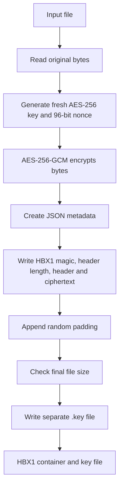
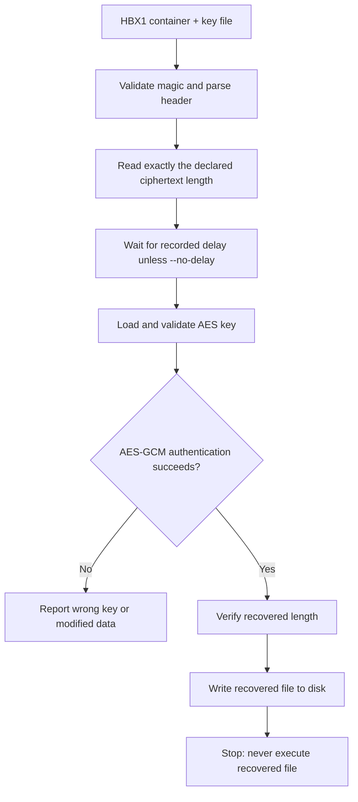
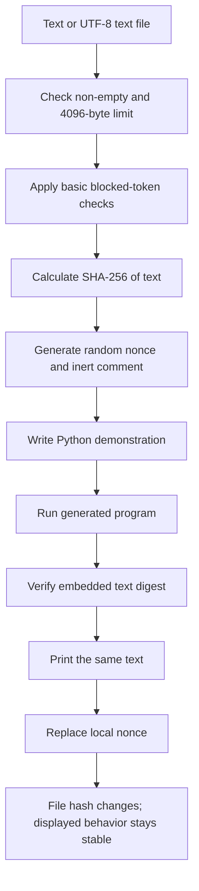
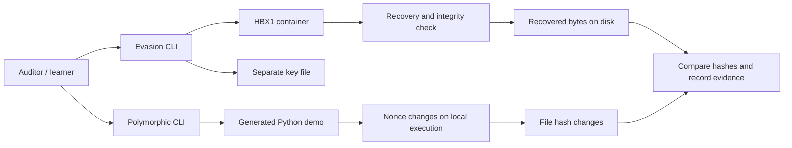

# Hidden-Bytes — Safe Educational Edition

> **Purpose:** study binary containers, authenticated encryption, file-size manipulation, file-level polymorphism, self-modification, integrity checking, and defensive detection in a controlled lab.
>
> **Safety boundary:** this edition does not implement antivirus evasion, a working reverse shell, remote command execution, persistence, or automatic execution of encrypted files. It does not claim to bypass Microsoft Defender, VirusTotal, or any other security product.

## Contents

- [1. Project overview](#1-project-overview)
- [2. Subject and audit scope](#2-subject-and-audit-scope)
- [3. Requirements and setup](#3-requirements-and-setup)
- [4. Tool 1 — Evasion / HBX1 container](#4-tool-1--evasion--hbx1-container)
- [5. Tool 2 — Polymorphic generator](#5-tool-2--polymorphic-generator)
- [6. End-to-end lab walkthrough](#6-end-to-end-lab-walkthrough)
- [7. Technical concepts](#7-technical-concepts)
- [8. Diagrams](#8-diagrams)
- [9. Audit checklist and evidence](#9-audit-checklist-and-evidence)
- [10. Defensive analysis](#10-defensive-analysis)
- [11. Limitations and known caveats](#11-limitations-and-known-caveats)
- [12. Ethics and lab safety](#12-ethics-and-lab-safety)

---

## 1. Project overview

Hidden-Bytes is a command-line educational project with two separate programs:

| Program | Main purpose | Output | Does it execute the input file? |
|---|---|---|---|
| `evasion` | Encrypt a file into an authenticated HBX1 data container, add random padding, and recover the original after an optional delay | `.hbx` container and separate `.key` file | **No** |
| `polymorphic` | Generate a harmless Python program whose inert signature changes while its displayed text stays the same | A generated `.py` program | It executes only its own safe demo logic when the generated script is run; the supplied payload is displayed as text, not executed |

The `evasion` name is retained because it comes from the assignment. The implementation is a **container and encryption demonstration**, not an antivirus-evasion mechanism.

### What this project demonstrates

- AES-256-GCM authenticated encryption.
- A simple binary container format with a magic value, metadata, ciphertext, and padding.
- Exact final-size calculation for a requested padding increase.
- A recovery delay applied before decryption.
- Authentication failure when the wrong key or modified ciphertext is supplied.
- A generated program with randomized inert data and a self-updating signature.
- Why whole-file hashes change when even non-functional bytes change.
- How defenders can investigate unusual file structure and behavior.

### What it deliberately does not implement

- Bypassing or disabling endpoint protection.
- A claimed Defender or VirusTotal detection-bypass percentage.
- A PE loader or automatic execution of encrypted binaries.
- A reverse shell, remote listener, command-and-control, or remote command execution.
- Persistence, privilege escalation, stealthy process injection, or anti-analysis tricks.
- The optional bonus features from the original subject.

These exclusions are part of the scope, not unfinished features to silently assume are present.

---

## 2. Subject and audit scope

The original subject discusses binary manipulation, encryption, file-size changes, delayed behavior, polymorphism, reverse shells, and antivirus detection. This repository implements safe demonstrations of several underlying concepts, while leaving operational malware capabilities out.

| Subject / audit topic | This implementation | How to demonstrate it |
|---|---|---|
| Encrypt an input file | Implemented using AES-256-GCM | Encrypt, then recover and compare SHA-256 hashes |
| Modify final file size | Implemented using random padding | Compare original size and container size |
| Requested size increase | Exact to the rounded MiB amount requested | Check `stat` / file properties and the CLI's size report |
| Delay | Stored in metadata and enforced before recovery | Use a non-zero delay and observe the wait |
| Inspect binary/container structure | Implemented for HBX1 metadata | Run `--inspect` and examine the layout diagram |
| Polymorphic variants | Implemented with random nonce/comment data | Generate two files and compare hashes |
| Self-modification | Implemented by changing the generated script's nonce | Hash a generated script, run it, and hash it again |
| Stable behavior | Same embedded message is displayed on each run | Capture output from multiple runs |
| Native Windows PE output | Not generated by the scripts themselves | A `.py` file or `.exe` filename does not by itself establish PE validity |
| Defender / VirusTotal bypass | Not implemented or claimed | Record this as out of scope; do not report an unmeasured bypass rate |
| Reverse-shell connection | Not implemented | Explain the threat model and defensive telemetry; no shell or connection is created |
| Isolated Windows VM | Must be verified manually by the auditor | Capture hypervisor network and integration settings |
| Bonus features | None implemented | Mark as not implemented |

**Important audit wording:** the delay is a **recovery delay**, not an execution delay. The encrypted HBX1 file is data and is not launched as a program.

---

## 3. Requirements and setup

### Prerequisites

- Python 3.10 or newer.
- The packages listed in `requirements-dev.txt` (including `cryptography` and `pytest`).
- A terminal: PowerShell on Windows, or a shell on Linux/macOS.
- For the subject demonstration, a dedicated Windows 10/11 virtual machine configured and inspected by the auditor.

### Recommended repository layout

```text
Hidden-Bytes/
├── hidden_bytes/
│   ├── __init__.py
│   ├── evasion.py
│   └── polymorphic.py
├── tests/
├── requirements.txt
├── requirements-dev.txt
├── README.md
└── output/                  # generated examples; optional
```

The precise test filenames may differ in your checkout. Run the test command shown below from the project root.

### Windows PowerShell

```powershell
py -m venv .venv
.venv\Scripts\Activate.ps1
py -m pip install -r requirements-dev.txt

py -m hidden_bytes.evasion --help
py -m hidden_bytes.polymorphic --help
```

If PowerShell blocks virtual-environment activation due to local policy, use the Python executable in `.venv\Scripts\python.exe` directly rather than changing a system-wide execution policy just for this project.

### Linux / macOS

```bash
python3 -m venv .venv
source .venv/bin/activate
python3 -m pip install -r requirements-dev.txt

python3 -m hidden_bytes.evasion --help
python3 -m hidden_bytes.polymorphic --help
```

If the repository includes executable wrapper scripts, they may also be used:

```bash
./evasion --help
./polymorphic --help
```

### Isolated lab configuration

Before any Windows demonstration, ask the auditor to verify:

1. The VM uses **Host-Only** or **Internal Network** mode as required by the lab scope.
2. Shared folders, shared clipboard, and drag-and-drop are disabled.
3. A clean snapshot exists and can be restored.
4. Only owned, harmless test files are used.
5. No confidential organizational file is uploaded to a public scanning service.
6. Evidence is saved without exposing keys or sensitive sample contents.

A README cannot prove the VM is isolated. Isolation must be checked in the hypervisor settings.

---

## 4. Tool 1 — Evasion / HBX1 container

### 4.1 What it does

`hidden_bytes.evasion` reads an input file as bytes and packages an encrypted copy into an HBX1 container. It creates a fresh AES-256 key and a fresh 96-bit nonce, encrypts with AES-GCM, stores metadata, and appends random padding until the requested final size is reached.

The key is written to a separate file named `<output>.key`. The tool can inspect metadata and recover the original bytes after the configured delay. It never executes the recovered file.

### 4.2 Basic usage

Create a harmless text sample:

```powershell
Set-Content -Path sample.txt -Value "Hello from Hidden-Bytes"
```

Linux/macOS alternative:

```bash
printf 'Hello from Hidden-Bytes\n' > sample.txt
```

Encrypt it and add 1 MiB to the original file's size:

```powershell
py -m hidden_bytes.evasion --encrypt sample.txt --output sample.hbx --add-size 1 --delay 5
```

Linux/macOS:

```bash
python3 -m hidden_bytes.evasion \
  --encrypt sample.txt \
  --output sample.hbx \
  --add-size 1 \
  --delay 5
```

The command produces:

```text
sample.hbx       # encrypted data container
sample.hbx.key   # Base64-encoded AES-256 key; keep it private
```

`--add-size 1` means an additional **1 MiB** (1,048,576 bytes, subject to the tool's rounded MiB calculation) beyond the original input size. The container metadata and ciphertext must fit inside the requested final size; if they do not, the command reports an error instead of silently producing a smaller increase.

For a large-size demonstration similar to the assignment's example, use `--add-size 101`. This can create a large file even for a small input, so make sure the VM has enough disk space.

### 4.3 Inspect the container

```powershell
py -m hidden_bytes.evasion --inspect sample.hbx
```

Or:

```bash
python3 -m hidden_bytes.evasion --inspect sample.hbx
```

Inspection prints the header metadata without decrypting the payload. It does **not** reveal the encryption key or prove that the ciphertext is authentic; authentication is checked during recovery.

### 4.4 Recover the original file

```powershell
py -m hidden_bytes.evasion --decrypt sample.hbx --output recovered.txt --key sample.hbx.key
```

Linux/macOS:

```bash
python3 -m hidden_bytes.evasion \
  --decrypt sample.hbx \
  --output recovered.txt \
  --key sample.hbx.key
```

The delay stored in the container is applied before decryption. For a quick local test, `--no-delay` skips this wait:

```powershell
py -m hidden_bytes.evasion --decrypt sample.hbx --output recovered.txt --key sample.hbx.key --no-delay
```

**Audit note:** do not use `--no-delay` when demonstrating that the configured delay is enforced.

### 4.5 Verify recovery

PowerShell:

```powershell
Get-FileHash sample.txt -Algorithm SHA256
Get-FileHash recovered.txt -Algorithm SHA256
```

Linux/macOS:

```bash
sha256sum sample.txt recovered.txt
```

The two SHA-256 values should match. The container hash will normally differ because it contains encrypted bytes, metadata, and padding.

Check sizes:

PowerShell:

```powershell
(Get-Item sample.txt).Length
(Get-Item sample.hbx).Length
```

Linux/macOS:

```bash
stat -c '%n %s bytes' sample.txt sample.hbx
```

### 4.6 HBX1 binary format

```text
Offset
  |
  v
+----------------------+  4 bytes
| Magic: "HBX1"        |  Identifies this educational container
+----------------------+  4 bytes
| Header length        |  Unsigned 32-bit, big-endian integer
+----------------------+
| JSON metadata        |  Algorithm, nonce, original size/name,
|                      |  ciphertext length, recovery delay
+----------------------+
| AES-GCM ciphertext   |  Encrypted input + 16-byte authentication tag
| and authentication  |
| tag                  |
+----------------------+
| Random padding       |  Fills the requested final size
+----------------------+
```

The header's `ciphertext_length` tells the recovery code where the ciphertext ends. The parser does not need to interpret the random padding as ciphertext.

### 4.7 Encryption and recovery flow



Recovery:



### 4.8 Security properties and limitations

- **Confidentiality:** AES-GCM encrypts the input bytes.
- **Integrity/authenticity:** AES-GCM detects ciphertext or authenticated-data changes when decrypting with the correct key.
- **Fresh nonce:** the program generates a new key and nonce for each package. Reusing a GCM nonce with the same key is unsafe.
- **Key handling:** the separate `.key` file is convenient for a classroom demo, not a complete production key-management design. Anyone who obtains the key and container can recover the file.
- **Padding:** random padding changes size and can affect static inspection. It does not establish antivirus evasion.
- **Delay:** it is a wait before recovery, not a delayed execution mechanism.
- **Format:** HBX1 is a custom data container, **not a valid Windows PE executable**.

---

## 5. Tool 2 — Polymorphic generator

### 5.1 What it does

`hidden_bytes.polymorphic` generates a Python demonstration program that contains:

- A text payload (or the contents of a UTF-8 text file).
- A SHA-256 digest of that text.
- A random nonce used as a signature value.
- An inert random comment to make independently generated files different.

When the generated program runs, it checks that the embedded text matches the digest, prints the text, and updates its own nonce. Thus, its file hash changes while the displayed message remains the same.

The supplied payload is treated as **text**, not Python code. It is not passed to `eval`, `exec`, a shell, or a process launcher.

### 5.2 Generate a demonstration

PowerShell:

```powershell
py -m hidden_bytes.polymorphic --generate polymorphic_demo.py --payload "Hello from the safe payload"
```

Linux/macOS:

```bash
python3 -m hidden_bytes.polymorphic \
  --generate polymorphic_demo.py \
  --payload "Hello from the safe payload"
```

You can also supply a text file:

```powershell
Set-Content -Path message.txt -Value "This is text, not executable code."
py -m hidden_bytes.polymorphic --generate polymorphic_demo.py --payload message.txt
```

```bash
printf 'This is text, not executable code.\n' > message.txt
python3 -m hidden_bytes.polymorphic \
  --generate polymorphic_demo.py \
  --payload message.txt
```

The generator limits the payload to 4096 UTF-8 bytes and rejects some common shell/process-related tokens. **That token filter is only a basic guardrail, not a security sandbox or a reliable classifier.** The key safety property is that the payload is displayed as text rather than executed.

### 5.3 Observe the changing hash

PowerShell:

```powershell
Get-FileHash polymorphic_demo.py -Algorithm SHA256
py polymorphic_demo.py
Get-FileHash polymorphic_demo.py -Algorithm SHA256
py polymorphic_demo.py
Get-FileHash polymorphic_demo.py -Algorithm SHA256
```

Linux/macOS:

```bash
sha256sum polymorphic_demo.py
python3 polymorphic_demo.py
sha256sum polymorphic_demo.py
python3 polymorphic_demo.py
sha256sum polymorphic_demo.py
```

Expected observations:

1. The program prints the same payload message on each run.
2. It verifies the embedded payload's SHA-256 digest before printing.
3. It changes the nonce stored in its source file.
4. The file's SHA-256 hash changes after the self-modification.

The generated file must be writable for the self-modification step. If it is read-only or located in a directory where the user lacks write permission, the signature update can fail.

### 5.4 Generate two variants and compare them

Generate two files with the same text:

```bash
python3 -m hidden_bytes.polymorphic \
  --generate variant_a.py \
  --payload "Same visible behavior"

python3 -m hidden_bytes.polymorphic \
  --generate variant_b.py \
  --payload "Same visible behavior"

sha256sum variant_a.py variant_b.py
```

The files should have different hashes because their nonce and inert variant comment are randomized. The visible message remains the same.

### 5.5 Polymorphic flow



### 5.6 What “polymorphism” means in this demo

The example illustrates a narrow form of **file-level variation**: bytes change while the intended visible output stays the same. It does not implement machine-code mutation, a native PE rewriter, an encrypted executable loader, or antivirus evasion.

A `.exe` extension does not turn a Python script into a Windows PE file. If a reviewer requires a native executable for a benign demonstration, any packaging should be done separately with an approved application packager inside the isolated VM. That does not make it an evasion tool.

---

## 6. End-to-end lab walkthrough

Use harmless text samples first. These commands are intended to make the behavior easy to show to an auditor.

### Exercise A — Encryption, padding, recovery, and integrity

1. Create `sample.txt` containing a short message.
2. Encrypt it into `sample.hbx` with a short delay such as five seconds.
3. Inspect the header with `--inspect`.
4. Record the original and container file sizes.
5. Recover to `recovered.txt`.
6. Compare the original and recovered SHA-256 values.
7. Repeat recovery with a deliberately incorrect key file and record that authentication fails. Do not overwrite the original sample during this test.
8. Restore the correct key and verify recovery succeeds again.

### Exercise B — Polymorphism and stable output

1. Generate `polymorphic_demo.py`.
2. Record its SHA-256 hash.
3. Run it and record its output.
4. Record its hash again.
5. Run it a second time and record the hash/output.
6. Confirm that the output message remains the same while the source file hash changes.
7. Generate a second variant with the same message and compare its hash.

### Exercise C — Defensive discussion

For each exercise, document:

- What changed in the file?
- Which parts are metadata, encrypted bytes, or inert random data?
- What did the program verify?
- What evidence proves that the original file was recovered correctly?
- What should an endpoint or sandbox monitor?
- Which original subject requirements are deliberately excluded from this safe edition?

Do not claim a Defender or VirusTotal bypass based on file size, encryption, hash changes, or one scan result.

---

## 7. Technical concepts

### AES-256-GCM

AES is a symmetric cipher. “256” refers to the key size in bits. GCM is an authenticated-encryption mode: it encrypts the plaintext and produces an authentication tag. During decryption, a wrong key or modified authenticated ciphertext should cause authentication to fail rather than produce accepted plaintext.

The container stores the nonce and metadata, but not the AES key. The key is stored separately in `<output>.key`.

### SHA-256

SHA-256 maps input bytes to a 256-bit digest. It is useful for checking whether the original and recovered files are byte-for-byte identical. Even a small change in the generated Python source normally changes its SHA-256 digest, which is why the polymorphic demo's hash changes when its nonce changes.

### File size and random padding

The container is deliberately padded to a target size. Padding illustrates how file length and high-entropy data can complicate static inspection; it does not prove maliciousness or benignness. Defenders should inspect structure and behavior rather than treating a single size or entropy measurement as a verdict.

### PE structure versus HBX1

A Windows Portable Executable normally has a DOS header, PE/COFF headers, section headers, and sections. HBX1 has a different custom layout. If an input file happens to be a PE, this tool encrypts its bytes as opaque data; it does not preserve a directly executable PE image in the container.

### Reverse-shell threat model (discussion only)

A reverse shell typically has a target initiate an outbound connection and redirects command-interpreter input/output over that connection. This project does not create that connection or provide shell code. For the audit, discuss likely evidence: unexpected outbound connections, command interpreters launched by unusual parents, suspicious standard-handle redirection, and unexpected process/network relationships.

---

## 8. Diagrams

### Overall project map



### What changes and what stays the same?

| Demonstration | Changes | Stays the same / verified |
|---|---|---|
| HBX1 encryption | Output representation, size, metadata, ciphertext and padding | Correct recovery reproduces the original bytes |
| Polymorphic generation | Random nonce, inert comment, whole-file hash | Embedded text and intended printed message |
| Polymorphic execution | Nonce in the script source and consequently its hash | Payload text and digest verification logic |

---

## 9. Audit checklist and evidence

Use this checklist during the audit. Mark an item only after collecting evidence.

- [ ] **Setup:** record Python version and installed dependencies.
- [ ] **Isolation:** capture the VM's network mode and disabled integration features.
- [ ] **Encryption:** show the generated `.hbx` and separate `.key` files.
- [ ] **Container structure:** capture `--inspect` output and explain each field.
- [ ] **Size:** record the original and final byte lengths and verify the configured increase.
- [ ] **Delay:** demonstrate a non-zero recovery delay without `--no-delay`.
- [ ] **Recovery:** compare original and recovered SHA-256 hashes.
- [ ] **Integrity failure:** record that recovery with an incorrect key or tampered ciphertext fails authentication.
- [ ] **Polymorphism:** show that two independently generated variants have different hashes.
- [ ] **Self-modification:** show a generated script's hash before and after execution.
- [ ] **Stable output:** preserve output from multiple runs and show that the message stays the same.
- [ ] **Safety review:** verify that the payload is printed as text and no network or shell capability is present in the demonstration.
- [ ] **Limitations:** clearly identify Defender/VT bypass, executable encrypted-payload launching, and reverse-shell behavior as not implemented.
- [ ] **Evidence handling:** store logs/screenshots and test hashes without exposing key contents.

### Suggested evidence directory

```text
audit/
├── environment.txt
├── vm-isolation.png
├── evasion-inspect.json
├── size-results.txt
├── recovery-hashes.txt
├── wrong-key-test.txt
├── polymorphic-hashes.txt
├── polymorphic-output.txt
└── limitations-and-findings.md
```

These are suggested evidence filenames; the tools do not automatically create this directory or capture screenshots.

### Automated tests

Run the repository's tests from its root:

```bash
python3 -m pytest -q
```

On Windows:

```powershell
py -m pytest -q
```

A passing test suite is useful evidence but does not replace the manual isolation check or the demonstrations above. If no test file covers a requirement, report that gap instead of assuming it was tested.

---

## 10. Defensive analysis

The project illustrates patterns that defenders can investigate, but no single indicator is a reliable verdict.

- **Large overlays / unusual file length:** compare file size with declared executable sections and investigate unexpected appended data.
- **High entropy:** encrypted or compressed data often has high entropy, but high entropy alone does not prove malware.
- **Unexpected delay:** monitor long sleeps and consider longer or time-accelerated sandbox observation windows.
- **Changing hashes:** exact hashes identify exact byte sequences; inert changes can produce a new hash without changing visible behavior. Combine hashes with normalized/fuzzy similarity, signing status, code structure, process behavior, memory observations, and network telemetry.
- **Unexpected network activity:** monitor outbound connections from applications that do not normally need them, especially when combined with suspicious child processes or command interpreters.
- **Key handling:** protect key files with access controls; never commit real keys to source control or include them in audit screenshots.

Recommended controls include application control/allowlisting, least privilege, egress filtering, endpoint detection and response, protected logging, rapid patching, and isolated analysis environments.

---

## 11. Limitations and known caveats

1. **Not an antivirus bypass:** no Defender or VirusTotal evasion technique is implemented or claimed.
2. **No executable loader:** HBX1 is a data container. Recovered bytes are written to disk and never executed.
3. **No reverse shell:** the project does not open a remote connection or redirect a command interpreter.
4. **Not a native PE polymorpher:** the generator produces Python source and changes an inert signature.
5. **Token filtering is not a sandbox:** the polymorphic generator's blocked-token list is heuristic and cannot prove arbitrary input text is safe.
6. **Key file security is limited:** storing the key next to the container is suitable only for the educational exercise.
7. **Delay scope:** the delay is applied during recovery, not during execution of the original file.
8. **Manual isolation verification:** source code and README instructions cannot prove the VM is isolated.
9. **Bonus requirements:** anti-debugging, stealth memory execution, custom encryption, a GUI, and a detection tool are not implemented.
10. **Audit results must be measured:** do not claim a detection percentage or a pass without recorded, reproducible evidence.

---

## 12. Ethics and lab safety

Binary encryption, file mutation, and self-modification have legitimate uses in research and software protection, but they are dual-use. Test only in a written, authorized scope with owned samples and an isolated environment. Keep snapshots, use harmless payload text, and restore the VM after the exercise.

Do not disable endpoint protection, deploy obfuscated payloads, upload confidential third-party binaries to public multi-scanner services, or establish remote shells without explicit authorization. Report findings honestly, distinguish implemented features from excluded requirements, and preserve the evidence needed for another reviewer to reproduce the results.

### Questions to prepare for the stakeholder / auditor

- What is the HBX1 format and how is it parsed?
- Why is AES-GCM used, and what happens if the key or ciphertext is wrong?
- Why must a GCM nonce not be reused with the same key?
- How is the final container size calculated?
- At what stage is the delay enforced?
- What changes in a polymorphic run, and what remains stable?
- Why can a whole-file hash change without a meaningful change in behavior?
- Why is an HBX1 container not a PE executable?
- Which original subject requirements are not implemented, and why?
- What evidence supports each audit claim?
